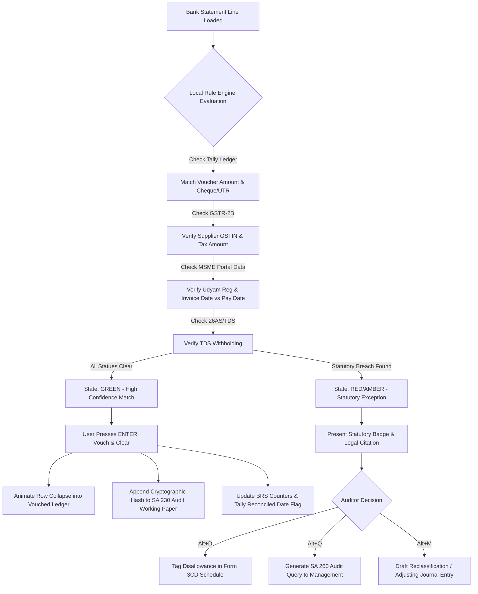

# UX/UI Reverse-Engineering Teardown: Xero vs. QuickBooks Online Bank Reconciliation
## Blueprint & Adaptation Architecture for ReconOS (Air-Gapped Indian CA Audit Desktop App)

---

### Executive Summary

Bank reconciliation sits at the emotional and operational core of modern financial workflows. In small business accounting software (Xero, QuickBooks Online), bank reconciliation is framed as **operational bookkeeping triage**: matching money in/out with invoices, bills, and nominal ledger accounts to maintain an up-to-date cash balance.

However, for **ReconOS**—an air-gapped, local-first desktop application engineered specifically for **Indian Chartered Accountants (CAs), audit managers, and statutory/tax auditors**—the user's objective is fundamentally different:
1. **Goal**: Not merely "balancing the cash book", but **Statutory Compliance, Vouching, and Fraud/Disallowance Detection** (e.g., Income Tax Act Form 3CD disallowances, CGST Act ITC eligibility, Companies Act CARO 2020 reporting, and ICAI Standards on Auditing SA 230/505).
2. **Data Topology**: Moving beyond 2-way matching (Bank $\leftrightarrow$ Ledger) into **4-way reconciliation** (Bank Statement $\leftrightarrow$ Tally/ERP Ledger $\leftrightarrow$ GSTR-2B / E-way Bills $\leftrightarrow$ 26AS / AIS / MSME Udyam status).
3. **Environment**: 100% offline/air-gapped, high-velocity keyboard navigation (Tally-native muscle memory), and zero data-loss resilience.

This teardown provides a forensic analysis of the UX patterns, visual design, and interaction mechanics of Xero and QuickBooks Online, followed by a prescriptive design system and UI blueprint tailored for ReconOS.

---

## 1. Deep Dive: Xero Bank Reconciliation Reverse-Engineering

Xero pioneered the modern bank reconciliation interface. Its core design achievement was transforming a tedious tabular reconciliation chore into a **satisfying, game-like "Zero Inbox" triage experience**.

### 1.1 Two-Column Card Matching Mechanics

```
+-------------------------------------------------------------------------------------------------------+
|  Xero Bank Reconciliation: Business Bank Account (123-456-7890)                                      |
|  Review 28 statement lines   |   Statement Balance: ₹4,12,450.00   |   Xero Balance: ₹3,85,120.00    |
+-------------------------------------------------------------------------------------------------------+
|  BANK STATEMENT LINE (Left Column)           |  XERO SUGGESTED ACTION / LEDGER (Right Column)         |
+-------------------------------------------------------------------------------------------------------+
| [Row 1: EXACT MATCH DETECTED]                                                                         |
|  24 Oct 2026                                 |  [ Match (1) ]  Create  Transfer  Discuss              |
|  Apex Technologies Pvt Ltd                   |  ----------------------------------------------------  |
|  NEFT / UTR: HDFCN2629810482                 |  Apex Technologies (Inv #INV-2026-088)                 |
|  Spent: ₹45,000.00                           |  Due: 20 Oct 2026    |  Amount Due: ₹45,000.00         |
|                                              |                                           [   OK   ]   |
+-------------------------------------------------------------------------------------------------------+
| [Row 2: NO AUTOMATIC MATCH]                                                                           |
|  25 Oct 2026                                 |  Match  [ Create ]  Transfer  Discuss                  |
|  Office Supplies Depot                       |  ----------------------------------------------------  |
|  Debit Card POS 8841                         |  Who:      [ Office Supplies Depot         ]           |
|  Spent: ₹3,420.00                            |  What:     [ 420 - Office Expenses    [v]  ]           |
|                                              |  Why:      [ Monthly stationery purchase    ]           |
|                                              |  Tax Rate: [ 18% GST on Expenses      [v]  ]  [   OK   ]   |
+-------------------------------------------------------------------------------------------------------+
```

#### Structural Anatomy
1. **Left Column (Statement Line - The Source of Truth)**:
   - Width: ~40%–45% of the viewport width.
   - Elements: Date, Payee/Transaction Description, Reference/Cheque/UTR number, and Amount (strictly formatted into distinct `Spent` or `Received` columns).
   - Visual Treatment: Neutral slate/grey surface (`#F4F5F7` or clean white with subtle grey borders). Text is immutable—it directly reflects the bank feed or uploaded statement file.
2. **Right Column (Xero Ledger Suggestions & Controls)**:
   - Width: ~55%–60% of viewport.
   - Elements: Tabbed interaction deck (`Match`, `Create`, `Transfer`, `Discuss`), matched document preview card, difference display, and the iconic green `OK` action button.
   - Visual Treatment: When an exact match is discovered, the entire card takes on a soft green border/accent (`#E3FCEF` background fill or green highlight) to signal high machine confidence.

### 1.2 The Action Verbs & Interaction Flows

#### A. `Match` (1:1, 1:Many, Many:1, and Splits)
- **1:1 Match**: If a single unpaid invoice, bill, or recorded transaction matches the amount and roughly aligns with the date ($\pm$ threshold) and payee name, Xero auto-selects the `Match` tab and renders the invoice details with a prominent green `[ OK ]` button.
- **Find & Match (Modal / Search)**: If the automatic algorithm fails or if the bank transaction represents a batch payment (e.g., 1 payment paying 3 vendor bills), clicking `Find & Match` expands an overlay list where users can filter by Name, Date, or Amount, select multiple checkboxes, or use the **Split** feature to allocate partial payments.
- **Adjustments**: Xero allows inline additions directly inside the Match tab for Bank Fees or Minor Discrepancies (e.g., ₹20 bank charges deducted from payment).

#### B. `Create` (Inline Ledger Posting)
- Used when no bill or invoice was pre-entered.
- Fields: **Who** (Contact / Vendor / Customer), **What** (Chart of Accounts selector), **Why** (Description / Narration), and **Tax Rate** (VAT / GST drop-down).
- Instant persistence: Submitting does not require opening an external voucher screen; clicking `OK` immediately posts a spend/receive money transaction to the GL and clears the line simultaneously.

#### C. `Transfer` (Contra / Inter-Account Transfers)
- Exclusively dedicated to movements between the entity's own tracked bank accounts or credit cards.
- Dropdown selector for the target bank account.
- Eliminates duplicate entries: when the user reconciles the sending bank account via `Transfer`, Xero automatically creates a paired pending match on the receiving bank account's reconciliation screen.

#### D. `Discuss` (Collaborative Sticky Note)
- An inline chat/note box embedded directly into the transaction row.
- **Use case**: A bookkeeper encounters an ambiguous transaction (`"IMPS-9812481-MUMBAI"` for ₹1,25,000) and writes: *"What was this transfer for? Please provide invoice."*
- When the business owner logs into Xero, they see the question highlighted in orange and can reply in place. The note stays pinned to the bank statement line until resolved.

### 1.3 Micro-Interactions: The Row Collapse Paradigm

The signature UX mechanic of Xero is the **Zero-Inbox Row Collapse**:
```
User clicks [ OK ]
      │
      ▼
1. Micro-feedback: [ OK ] button morphs into checkmark or momentary green pulse.
2. Row highlights briefly in bright emerald green (#36B37E at 20% opacity).
3. Height collapse: CSS max-height transitions smoothly from 120px to 0px over 280ms (cubic-bezier(0.4, 0, 0.2, 1)).
4. Neighboring rows below slide upward seamlessly.
5. Counter updates: "28 items to reconcile" decrements to "27 items to reconcile".
6. Statement Balance vs. Xero Balance delta ticker animates to reflect the newly cleared ledger value.
```
**Psychological Impact**: This eliminates visual clutter, prevents cognitive re-scanning of already-cleared rows, and delivers consistent dopamine loops during repetitive 500-line reconciliations.

### 1.4 How Unmatched Lines are Handled
- Unmatched lines are **never** hidden or grouped into an ambiguous error bucket. They remain in the main stream in strict chronological sequence.
- Visually, while matched lines exhibit an inviting green `[ OK ]` button, unmatched lines show an open `[ Create ]` form or an empty `[ Match ]` tab with a link: *"Find & Match"*.
- The user's eye instantly spots unmatched items because of the missing green button and the presence of form fields.

---

## 2. Deep Dive: QuickBooks Online (QBO) Reverse-Engineering

QuickBooks Online approaches bank reconciliation through a bifurcated architecture:
1. **Bank Transactions (Feed Triage / Category Review)**: The entry point where live bank feed items are categorized or matched to existing entries.
2. **Reconciliation Screen (Month-End Close / Balance Attestation)**: The formal accounting screen where the closing bank statement balance is reconciled against cleared transactions.

### 2.1 QBO Bank Transactions (Feed Triage)

```
+--------------------------------------------------------------------------------------------------------------------+
| QBO Bank Transactions: HDFC Current Account (**** 4102)   [Update Feed]  [Batch Actions (3)]                       |
| Tabs: [For Review (42)]   [Categorized]   [Excluded]                                                               |
+----+-------------+-------------------------+--------------------+------------+-----------+-------------------------+
| [ ]| DATE        | DESCRIPTION             | PAYEE              | SPENT      | RECEIVED  | CATEGORY / MATCH | ACTION|
+----+-------------+-------------------------+--------------------+------------+-----------+-------------------------+
| [ ]| 24 Oct 2026 | INFOSYS TECHNOLOGIES    | Infosys Tech       |            | ₹1,50,000 | [1 match found ] | [Match] |
|    |             | NEFT-INF-2026-991       |                    |            |           | Bill #9012       |         |
+----+-------------+-------------------------+--------------------+------------+-----------+-------------------------+
| [v]| 25 Oct 2026 | UBER INDIA TECH         | Uber Rides         | ₹450.00    |           | Travel Expense   | [Add]   |
|    | ------------------------------------------------------------------------------------------------------------- |
|    |  (o) Categorize    ( ) Find match    ( ) Record transfer    ( ) Record as credit card payment                |
|    |  Vendor: [ Uber India          [v] ]   Category: [ Travel & Conveyance   [v] ]   Tax: [ 5% GST  [v] ]         |
|    |  Memo:   [ Client site commute     ]   [ ] Billable to customer                                               |
|    |                                                                         [ Split ]  [ Confirm / Add ]          |
+----+-------------+-------------------------+--------------------+------------+-----------+-------------------------+
```

#### Structural & UX Characteristics
- **Table / Data Grid Paradigm**: Unlike Xero's distinct two-column cards, QBO uses a dense standard HTML table.
- **Inline Accordion Drawer**: Clicking anywhere on a row expands an inline drawer directly beneath it. This drawer houses radio buttons (`Categorize`, `Find match`, `Record transfer`, `Record as CC payment`), vendor drop-downs, split tools, and tax options.
- **Batch Acceptance**: QBO includes checkboxes on the left margin. Users can multi-select 10 rows with "1 match found" and click a top-level `Accept (10)` button to clear them en masse.

### 2.2 QBO Formal Reconcile Screen

```
+--------------------------------------------------------------------------------------------------------------------+
| Reconcile: Business Checking (**** 4102)                                                          [ Finish Now ]   |
| Statement Ending Date: 31/10/2026   |   Statement Ending Balance: ₹8,45,210.00                                     |
+--------------------------------------------------------------------------------------------------------------------+
|  BEGINNING BALANCE       PAYMENTS CLEARED (14)       DEPOSITS CLEARED (8)       CLEARED BALANCE      DIFFERENCE        |
|     ₹5,10,000.00      -       ₹1,42,100.00        +       ₹4,77,310.00       =     ₹8,45,210.00       ₹0.00        |
|                                                                                                  [ SUCCESS TICK ]  |
+--------------------------------------------------------------------------------------------------------------------+
| Filter by: [ All Dates [v] ]  [ All Transactions [v] ]  [ Search:                ]               Clear All | Select All|
+---+-------------+------+-------------+--------------------+-------------------------+------------+----------------+
|CLR| DATE        | TYPE | REF NO.     | PAYEE              | MEMO                    | SPENT      | RECEIVED       |
+---+-------------+------+-------------+--------------------+-------------------------+------------+----------------+
|[x]| 02 Oct 2026 | CHQ  | 004128      | Tata Motors        | Vehicle repair          | ₹14,200.00 |                |
|[x]| 05 Oct 2026 | DEP  | RTGS-902    | Reliance Retail    | Sales settlement        |            | ₹2,40,000.00   |
|[ ]| 28 Oct 2026 | CHQ  | 004129      | Vardhman Steels    | Advance payment         | ₹85,000.00 |                |
+---+-------------+------+-------------+--------------------+-------------------------+------------+----------------+
```

#### Structural & UX Characteristics
1. **Header KPI Summary Bar**: The mathematical core ($Beginning - Payments + Deposits = Cleared$). The `Difference` counter is prominently styled. If $Difference \ne 0.00$, it is styled in bold amber/red; when it hits zero, it turns green with celebratory visual reinforcement.
2. **Two-Way Split View or Filtered List**: Users can toggle between viewing Payments (Debits) and Deposits (Credits) separately or in a unified chronological view.
3. **Checkbox Clearing**: Article clerks manually or semi-automatically tick off checkboxes in the `CLR` column against physical or PDF bank statements.

---

## 3. Side-by-Side Architectural Comparison: Xero vs. QuickBooks Online

| UX Dimension | Xero Bank Reconciliation | QuickBooks Online (QBO) |
| :--- | :--- | :--- |
| **Primary Visual Model** | **Juxtaposed 2-Column Cards** (Statement vs. Action). Spatial separation of Bank vs. Ledger. | **Tabular Data Grid with Accordion Drawers**. Standard single-table structure. |
| **Matching Presentation** | Direct side-by-side comparison. Exact match appears immediately in place with zero clicks needed to inspect. | Match label appears in a table cell (`1 match found`); requires expanding the accordion to inspect full details. |
| **Row Completion Feedback** | **Animated row collapse** (Zero Inbox model). Card vanishes from view, reducing remaining clutter. | Row remains visible in table; status updates to "Matched" or vanishes only upon explicit filter refresh/batch accept. |
| **Batch Capabilities** | Limited (intentionally focused on row-by-row cognitive verification). | High (select-all checkboxes for rules, mass accept). Prone to blind bulk-accept errors. |
| **Collaboration** | Built-in **"Discuss" tab** with threaded sticky notes on the statement line itself. | Notes relegated to general memo fields or audit log; no direct inline client-discussion thread. |
| **Handling Splits** | `Find & Match` $\rightarrow$ Split adjustment modal. | Expand accordion $\rightarrow$ `Split` button $\rightarrow$ Multi-line itemized sub-table. |
| **Triage Velocity** | Extremely rapid for 1:1 matches (rapid clicks down the `OK` column). | Slower single-item review due to accordion clicks, but faster for high-volume automated rules. |
| **Mental Framing** | *"Clear the feed line by line like an inbox."* | *"Review the ledger table and adjust categories."* |

---

## 4. Why Xero & QBO Fail Indian CAs During Statutory Audits

Xero and QBO were engineered for **business owners and internal bookkeepers** in Anglo-American jurisdictions (US GAAP, UK GAAP, Australian Tax). When applied to Indian Chartered Accountants conducting **Statutory Audits under the Companies Act 2013** and **Tax Audits under Section 44AB of the Income Tax Act 1961**, their UX models break down entirely:

```
                           THE JURISDICTIONAL MISALIGNMENT
┌───────────────────────────────────────────┐      ┌───────────────────────────────────────────┐
│         XERO / QBO PARADIGM               │      │           RECONOS AUDIT PARADIGM          │
├───────────────────────────────────────────┤      ├───────────────────────────────────────────┤
│ • "Did the money match the invoice?"      │      │ • "Is the supplier's GST reflected in 2B?"│
│ • Commercial convenience over compliance  │      │ • Sec 16(2)(aa) statutory ITC disallowance│
│ • 2-Way Match: Bank <---> Ledger          │      │ • 4-Way Match: Bank <-> Tally <-> 2B <-> IT│
│ • No concept of MSME 45-day payment limits│      │ • Sec 43B(h) MSME mandatory add-back calc │
│ • No cash limit restrictions              │      │ • Sec 40A(3) >₹10k cash audit red-flag    │
│ • Cloud-dependent / Multi-tenant SaaS     │      │ • Air-gapped / Local-only confidentiality │
│ • Casual mouse-driven UI                  │      │ • High-velocity Tally-style keyboard flow │
└───────────────────────────────────────────┘      └───────────────────────────────────────────┘
```

### The Specific Indian Compliance Blindspots
1. **GST Section 16(2)(aa)**: Under Indian GST law, a taxpayer cannot claim Input Tax Credit (ITC) unless the supplier has filed their GSTR-1 and the invoice appears in the buyer's **GSTR-2B**. Xero/QBO will happily match a bank payment to an ERP bill even if the supplier is a fraudulent non-filer whose GSTIN is cancelled!
2. **Income Tax Section 43B(h) (MSME Mandate)**: Any payment due to a Micro or Small Enterprise beyond 45 days (with written agreement) or 15 days (without agreement) is **disallowed as an expense** in the current fiscal year and added back to taxable income. Xero/QBO have zero temporal awareness of invoice date vs. MSME supplier classification vs. bank payment clearance date.
3. **Income Tax Section 40A(3)**: Aggregate payments made to a person in a single day in cash exceeding ₹10,000 are 100% disallowed.
4. **TDS Withholding (Sections 194C, 194J, 194Q) & TCS (Section 206C)**: Bank payments must be correlated with TDS deduction vouchers and Form 26AS / Challan 281 quarterly deposits.
5. **CARO 2020 Reporting (Companies Auditor's Report Order)**: Clause 3(ii)(b) requires statutory auditors to verify whether quarterly returns of current assets submitted to banks agree with books of account. Clause 3(ix) requires reporting of defaults in loan repayments.
6. **ICAI Standards on Auditing (SA 230 & SA 505)**: Every audit decision requires an immutable working paper, audit trail, query to management, and verification cross-reference.

---

## 5. What ReconOS Must BORROW vs. What It Must DO DIFFERENTLY

```
+-------------------------------------------------------------------------------------------------------------+
|                                     RECONOS DESIGN ARCHITECTURE                                             |
+-------------------------------------------------------------------+-----------------------------------------+
| WHAT RECONOS MUST BORROW (From Xero & QBO)                        | WHAT RECONOS MUST DO DIFFERENTLY        |
+-------------------------------------------------------------------+-----------------------------------------+
| 1. The Juxtaposed Two-Column Canvas (from Xero):                  | 1. 4-Way Statutory Matching Panels:     |
|    Statement line on left, matched ERP voucher on right.           |    Bank <-> Tally/ERP <-> GSTR-2B <->   |
|                                                                   |    26AS / MSME Udyam Database.          |
+-------------------------------------------------------------------+-----------------------------------------+
| 2. Zero-Inbox Row Collapse (from Xero):                           | 2. Prominent Statutory Badge System:    |
|    Smooth height collapse upon audit clearance to manage          |    Every match displays real-time flags:|
|    5,000+ line audit fatigues.                                    |    [16(2)(aa) OK] [43B(h) RISK] [TDS OK]|
+-------------------------------------------------------------------+-----------------------------------------+
| 3. High-Integrity Difference Meter (from QBO):                    | 3. Statutory Action Verbs:              |
|    Dynamic persistent header displaying Unreconciled Timing       |    Replace casual "Add/Transfer" with   |
|    Differences vs. Unexplained Audit Discrepancies.               |    [Vouch & Clear], [Audit Query],      |
|                                                                   |    [Tax Disallowance], [Propose MJE].   |
+-------------------------------------------------------------------+-----------------------------------------+
| 4. Contextual Adjustment Tools:                                   | 4. 100% Air-Gapped / Local-First Engine:|
|    Inline handling of bank charges, interest, auto-debits         |    Embedded DuckDB/SQLite; zero cloud   |
|    without launching external journal entry wizards.              |    uploads. Client financial data never |
|                                                                   |    leaves the audit laptop.             |
+-------------------------------------------------------------------+-----------------------------------------+
| 5. Collaborative Discussion Thread (from Xero):                   | 5. Tally-Native Keyboard Ergonomics:    |
|    Transformed into SA 230 Working Paper Query generator          |    Full Alt/Ctrl/Fn shortcuts, Numpad   |
|    addressed to client management (SA 260).                       |    triage, zero mouse dependency.       |
+-------------------------------------------------------------------+-----------------------------------------+
```

---

## 6. ReconOS UI/UX Specification & Wireframe Blueprint

### 6.1 Desktop Layout Architecture
ReconOS utilizes an ultra-dense, dark/light theme, high-contrast desktop layout engineered for 1080p and 4K displays.

```
+----------------------------------------------------------------------------------------------------------------------------------------------------+
| ReconOS v2.4 (Air-Gapped Edition)  | Client: SHREE GANESH TRADERS LTD | FY: 2025-26 (AY 2026-27) | Bank: HDFC CURRENT A/C 50200019284912                   |
+----------------------------------------------------------------------------------------------------------------------------------------------------+
| [F1 Help] [F2 Period] [F3 Bank] [F4 Match Mode: 4-Way [v]] [F5 Re-Scan OCR] [F9 Export Working Paper (SA 230)] [Alt+Q Query Mgr] [Alt+S BRS Report]|
+----------------------------------------------------------------------------------------------------------------------------------------------------+
|  STATEMENT BALANCE (HDFC)   |  ERP LEDGER BALANCE (TALLY)  |  TIMING DIFFERENCE (BRS)  |  AUDIT EXCEPTIONS (UNEXPLAINED)  |  SEC 43B(h) AT RISK   |
|       ₹ 1,48,22,410.50      |       ₹ 1,32,18,900.00       |     ₹ 14,80,510.50        |      ₹ 1,23,000.00 (3 items)     |   ₹ 8,42,000.00 (2)   |
+----------------------------------------------------------------------------------------------------------------------------------------------------+
| FILTERS: [ ] Exceptions Only  [ ] High Risk (GST/TDS)  [ ] Unvouched Only  | Search: [/ or Alt+F] __________________________ | Filter: [All Rows  [v]]|
+====================================================================================================================================================+
| LEFT: BANK STATEMENT FEED (Source: HDFC_OCT2026.pdf)         | RIGHT: TALLY PRIME / ERP & STATUTORY RECONCILIATION MATCH                          |
+====================================================================================================================================================+
| [CARD 1: CLEAN 4-WAY STATUTORY MATCH - STATUS: AUTO-VERIFIED]                                                                                      |
| 14-OCT-2026 | Chq/Ref: CMS/00291829104/INFRA                | TALLY VOUCHER: Payment #V-8941 | Dr. Kuber Cement Mills Ltd                         |
| Narration: NEFT CR-UTIB000102-KUBER CEMENT MILLS             | Ledger Head: 2001 - Sundry Creditors (Raw Materials)                                |
| Debit (Spent): ₹ 4,72,000.00                                 | Voucher Date: 12-OCT-2026 | Amount: ₹ 4,72,000.00 [MATCHED]                         |
| Balance: ₹ 1,43,50,410.50                                    | ---------------------------------------------------------------------------------- |
|                                                              | STATUTORY COMPLIANCE AUDIT SIGNALS:                                                |
|                                                              |  [x] GST 16(2)(aa): Inv #KCM/108 in GSTR-2B | Taxable: ₹4,00,000 GST: ₹72,000 (MATCH)|
|                                                              |  [x] MSME 43B(h): Enterprise Type: MEDIUM (Exempt from 45-day disallowance)         |
|                                                              |  [x] TDS 194C: Deducted @ 1% on bill (Challan 281 verified)                         |
|                                                              |                                                      [ VOUCH & CLEAR (Enter) ]      |
+----------------------------------------------------------------------------------------------------------------------------------------------------+
| [CARD 2: CRITICAL AUDIT RED-FLAG - MSME SEC 43B(h) DELAY + GST 16(2)(aa) INELIGIBILITY]                                                           |
| 18-OCT-2026 | Chq/Ref: NEFT-N2629019284                      | TALLY VOUCHER: Payment #V-9012 | Dr. Apex Plastic Moulds Enterprises               |
| Narration: NEFT TO APEX PLASTIC UDYAM-MH-02-001928           | Ledger Head: 2001 - Sundry Creditors (Packaging)                                   |
| Debit (Spent): ₹ 2,36,000.00                                 | Voucher Date: 17-OCT-2026 | Amount: ₹ 2,36,000.00                                   |
| Balance: ₹ 1,41,14,410.50                                    | ---------------------------------------------------------------------------------- |
|                                                              | [!] STATUTORY VIOLATIONS DETECTED:                                                 |
|                                                              |  [!] SEC 43B(h) DISALLOWANCE: Invoice Date: 12-MAY-2026 | Paid: 18-OCT-2026        |
|                                                              |      Days Elapsed: 159 Days (Max Permitted: 45 Days).                              |
|                                                              |      *Tax Auditor Note: Disallowance under Sec 43B(h) mandatory in Form 3CD Cl 22*|
|                                                              |  [!] GST 16(2)(aa) DEFECT: Supplier GSTR-1 NOT FILED. Missing from GSTR-2B.        |
|                                                              |      *ITC of ₹36,000 at risk of recovery under Rule 37A / Sec 16(2)(aa)*           |
|                                                              | ---------------------------------------------------------------------------------- |
|                                                              | ACTIONS: [Alt+D Tag Disallowance] [Alt+Q Raise Client Query] [Alt+M Propose MJE]   |
+----------------------------------------------------------------------------------------------------------------------------------------------------+
| [CARD 3: BRS TIMING ITEM - CHEQUE ISSUED BUT NOT PRESENTED]                                                                                        |
| [NO BANK STATEMENT LINE EXISTS]                              | TALLY VOUCHER: Payment #V-9140 | Chq # 004128 Dated: 28-OCT-2026                    |
| (Unpresented Cheque identified from Tally Bank Book)         | Payee: Bharat Heavy Movers | Amount: ₹ 3,50,000.00                                  |
|                                                              | Status: Cheque not presented up to 31-OCT-2026                                      |
|                                                              | Verified cleared in subsequent month (04-NOV-2026).                                |
|                                                              | Classification: [ BRS Timing Difference: Cheque Issued Not Cleared (Alt+B) ]       |
+----------------------------------------------------------------------------------------------------------------------------------------------------+
| [CARD 4: UNEXPLAINED BANK DEBIT - POTENTIAL CARO CLAUSE 3(ix) OR SUSPICIOUS TRANSACTION]                                                           |
| 29-OCT-2026 | Chq/Ref: DIRECT-DEBIT-ECS-9941                 | NO ERP VOUCHER FOUND IN TALLY DATABASE                                             |
| Narration: ACH DEBIT - BAJAJ FINANCE EMI LOAN A/C 9918       | Search Tally: [ Alt+F Find Matching Voucher ]                                      |
| Debit (Spent): ₹ 1,23,000.00                                 | ---------------------------------------------------------------------------------- |
| Balance: ₹ 1,39,91,410.50                                    | [!] AUDIT RED-FLAG:                                                                |
|                                                              |  1. Unrecorded Bank Loan EMI. Unlisted loan account in ERP books.                   |
|                                                              |  2. CARO 2020 Clause 3(ix): Non-disclosure of borrowings / defaults.              |
|                                                              | ACTIONS: [ Create Audit Query Memo (Alt+Q) ]  [ Draft MJE Adjustment (Alt+A) ]     |
+----------------------------------------------------------------------------------------------------------------------------------------------------+
```

---

### 6.2 Detailed Interaction Flows & State Transitions

#### Flow 1: 4-Way Match & Clear (`Enter` or Single Click)


#### Flow 2: Handling the dreaded Section 43B(h) MSME Disallowance
1. **Trigger**: Bank feed shows payment to a vendor on 18-Oct-2026.
2. **ERP Scan**: Tally voucher indicates invoice date was 12-May-2026 (159 days gap).
3. **Local Database Look-up**: Vendor's GSTIN is cross-referenced with the offline cached MSME Udyam classification database (`Apex Plastic = Micro Enterprise, Manufacturer`).
4. **Law Applied**: Section 15 of MSMED Act mandates payment within 45 days. Section 43B(h) dictates that since payment was not made within FY 2025-26 on or before due date, it is **disallowed**.
5. **ReconOS Presentation**:
   - The card displays an amber warning bar with high visual hierarchy.
   - Text citation: *"Sec 43B(h) Violation: Delay of 114 days beyond statutory 45-day ceiling. Amount: ₹2,36,000."*
   - Pre-calculated Tax Effect: *"Tax impact @ 25% + 4% Cess = ₹61,360 additional tax payable."*
6. **Action**: The Auditor hits `Alt+D`. ReconOS flags the item and immediately appends it to the **Form 3CD Clause 22 Working Paper Schedule**, ready for the CA's signature.

---

### 6.3 Audit Action Verbs Re-engineered

Unlike Xero's casual accounting verbs, ReconOS adopts formal, legally sound auditing terminology:

```
+------------------+-----------------------+---------------------------------------------------------------------------------+
| Xero / QBO Verb  | ReconOS Audit Action  | Statutory & Audit Consequence                                                   |
+------------------+-----------------------+---------------------------------------------------------------------------------+
| [ Match / OK ]   | [ VOUCH & CLEAR ]     | Marks transaction as audited under SA 500 (Audit Evidence). Sets clearance date |
|                  | (Shortcut: Enter)     | in Tally Bank Reconciliation sub-table. Hashes entry into working papers.       |
+------------------+-----------------------+---------------------------------------------------------------------------------+
| [ Discuss ]      | [ AUDIT QUERY (SA260)]| Formulates a formal Audit Query Memo to the CFO/Promoters under SA 260.         |
|                  | (Shortcut: Alt+Q)     | Captures management responses with timestamped document attachments.           |
+------------------+-----------------------+---------------------------------------------------------------------------------+
| [ Create / Add ] | [ PROPOSE MJE ]       | Drafts a Management Journal Entry (Audit Adjustment). Does NOT silently alter   |
|                  | (Shortcut: Alt+M)     | client books. Generates proposed rectification entry with impact on P&L.        |
+------------------+-----------------------+---------------------------------------------------------------------------------+
| [ Transfer ]     | [ CONTRA & KITING ]   | Flags inter-bank transfers. Enforces strict audit against "Window Dressing"     |
|                  | (Shortcut: Alt+T)     | and "Cheque Kiting" around year-end close (31st March).                         |
+------------------+-----------------------+---------------------------------------------------------------------------------+
| [ NEW ACTION ]   | [ TAG DISALLOWANCE ]  | Tags transaction for disallowance under Income Tax Act (43B(h), 40A(3), 40(a)) |
|                  | (Shortcut: Alt+D)     | and pipes directly into Form 3CD Tax Audit e-filing schema.                     |
+------------------+-----------------------+---------------------------------------------------------------------------------+
| [ NEW ACTION ]   | [ BRS TIMING ITEM ]   | Distinguishes legitimate timing lag (unpresented cheques, uncleared deposits)   |
|                  | (Shortcut: Alt+B)     | from substantive accounting omissions. Forms the statutory BRS statement.       |
+------------------+-----------------------+---------------------------------------------------------------------------------+
```

---

### 6.4 The "Discuss" Evolution: SA 230 Working Paper & Client Query Modal

When an auditor hits `Alt+Q` on any line, the following modal overlays the screen, enabling instant drafting of audit queries without leaving the keyboard:

```
+--------------------------------------------------------------------------------------------------------------------+
| AUDIT QUERY & MANAGEMENT OBSERVATION (SA 260 / SA 230 DOCUMENTATION)                                 [Esc: Close]  |
+--------------------------------------------------------------------------------------------------------------------+
| Transaction: 29-OCT-2026 | ACH DEBIT BAJAJ FINANCE | Amount: ₹ 1,23,000.00                                         |
+--------------------------------------------------------------------------------------------------------------------+
| QUERY TEMPLATE: [ (1) Unrecorded Loan EMI  [v] ]  Severity: [ (o) High Risk (CARO)  ( ) Moderate  ( ) Informational]|
+--------------------------------------------------------------------------------------------------------------------+
| STATUTORY AUDIT OBSERVATION (Drafted for Client Management):                                                       |
| +----------------------------------------------------------------------------------------------------------------+ |
| | During the course of our bank reconciliation audit for HDFC A/c 50200019284912, we noted an automated ACH      | |
| | debit of ₹1,23,000 on 29-10-2026 favoring Bajaj Finance Ltd. No corresponding loan liability or interest       | |
| | entry is recorded in the Tally books of account.                                                               | |
| |                                                                                                                | |
| | Kindly provide:                                                                                                | |
| | 1. Sanction letter and loan account statement from Bajaj Finance Ltd.                                          | |
| | 2. Purpose of borrowing and board resolution under Section 179(3) of Companies Act 2013.                       | |
| | 3. Clarification for non-recording of loan obligation in primary financial records.                            | |
| | Note: Non-disclosure may invite reporting under CARO 2020 Clause 3(ix).                                        | |
| +----------------------------------------------------------------------------------------------------------------+ |
| Management Response (Leave blank if pending):                                                                      |
| [                                                                                                                ] |
| Client Contact to Email/WhatsApp: [ CFO - cfo@shreeganesh.com                           ]                          |
| Attachment / Evidence: [ Upload Sanction PDF / Cheque Scan (Ctrl+U) ]                                              |
+--------------------------------------------------------------------------------------------------------------------+
| [ Alt+P: Print Query Memo ]      [ Alt+E: Export to Client Query Sheet ]      [ Enter: Save to SA 230 Workpapers ] |
+--------------------------------------------------------------------------------------------------------------------+
```

---

### 6.5 Complete Keyboard Navigation Matrix (Tally Muscle-Memory)

Indian audit assistants and CAs spend thousands of hours navigating Tally with arrow keys and letter shortcuts. ReconOS must ensure **100% of all operations can be performed without lifting hands to reach for a mouse**:

| Key Combination | Action in ReconOS |
| :--- | :--- |
| `Down Arrow` / `Up Arrow` | Navigate up and down the statement/reconciliation card stream. |
| `Enter` | **Vouch & Clear**: Accept the suggested match, perform 4-way check, animate collapse. |
| `Spacebar` | Select/Multi-select multiple statement lines for batch contra or batch fee allocation. |
| `Alt + A` | **Propose MJE**: Open adjusting journal entry drawer for missing bank fees, interest, or direct debits. |
| `Alt + D` | **Tag Disallowance**: Flag line under Income Tax Sec 40A(3), 43B(h), 40(a)(ia), etc. |
| `Alt + Q` | **Audit Query**: Open the SA 260 / SA 230 management observation modal. |
| `Alt + B` | **Tag as BRS Item**: Mark as timing difference (Cheque issued not presented / deposited not cleared). |
| `Alt + F` | **Deep Search**: Search Tally vouchers, GSTR-2B invoices, or statement narrations. |
| `Ctrl + Enter` | **Inspect Voucher**: Open read-only view of the matched Tally ERP voucher XML/ledger record. |
| `Alt + G` | **GSTR-2B Inspection**: Open side-car inspection drawer showing portal-level invoice metadata. |
| `F2` | Change Audit Period / Date filter range. |
| `F9` | Generate & Export CA Signed BRS & Audit Working Paper Package (PDF / Excel). |
| `Esc` | Close any modal / clear active search / cancel selection. |

---

## 7. Technical Architecture for Air-Gapped Desktop Operation

To guarantee compliance with ICAI confidentiality norms and ensure sub-second rendering across 50,000+ bank transactions:

```
┌──────────────────────────────────────────────────────────────────────────────────┐
│                      RECONOS AIR-GAPPED DESKTOP STACK                            │
├──────────────────────────────────────────────────────────────────────────────────┤
│ UI Layer:          Tauri 2.0 (Rust) + React 19 + Tailwind CSS + Lucide Icons    │
│ Virtualization:    @tanstack/react-virtual (60fps rendering across 50k rows)     │
│ Local Database:    DuckDB Embedded (OLAP analytical queries across GSTR & Tally) │
│ Statement Parser:  Native Rust PDF engine (extracts tables from HDFC/ICICI/SBI)  │
│ ERP Ingestion:     Tally Prime XML ODBC / JSON connector (Direct local port 9000)│
│ Air-Gap Security:  Zero telemetry, no outbound socket connections, local keys    │
└──────────────────────────────────────────────────────────────────────────────────┘
```

1. **Local Embedded DuckDB**: Stores bank statement lines, Tally vouchers, and GSTR-2B JSON files locally in memory/disk. Complex 4-way JOIN queries run in $<15\text{ ms}$.
2. **Virtualized Two-Column List**: Even with a full year of active transactions (e.g., 30,000 bank feed lines), `@tanstack/react-virtual` only mounts 12 DOM elements at any moment, maintaining smooth 60fps scrolling and instant collapse transitions.
3. **Local Encryption**: All client audit working papers and bank statements are stored using AES-GCM-256 with a CA master audit key.

---

## 8. Summary of Product Recommendations for ReconOS

1. **Adopt Xero's Two-Column Juxtaposition**: Reject QBO's accordion-in-table design. The human brain parses bank reconciliation most efficiently when the external proof (Bank Statement) and internal record (Ledger) sit side-by-side with clear matching vectors.
2. **Implement the Smooth Zero-Inbox Collapse**: Keep the auditor focused only on what remains unvouched. When an item is vouched (`Enter`), slide it away smoothly while updating the persistent BRS header metrics.
3. **Elevate Statutory Compliance into the Primary Match Engine**: Don't treat tax and GST as afterthought metadata. Make **Section 16(2)(aa)** and **Section 43B(h)** prominent badges directly on the reconciliation cards.
4. **Transform "Discuss" into "Audit Observations"**: Replace casual chat with formal **SA 260 / SA 230 Audit Query Memos** that directly generate client-ready query sheets and Tax Audit Form 3CD working paper annexures.
5. **Honor Tally Keyboard Muscle Memory**: Guarantee complete hands-on-keyboard velocity. An article clerk should be able to audit 500 lines in 20 minutes without ever touching a mouse.
