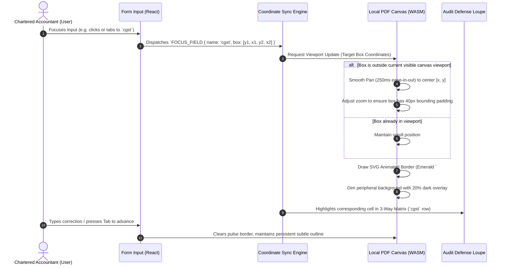

# UX/UI Reverse-Engineering Teardown: Dext Prepare vs. Hubdoc
**Comparative Analysis, Interaction Mechanics & Architectural Blueprint for ReconOS**

---

## Executive Summary

This reverse-engineering report decomposes the document ingestion, data extraction, and visual verification user experiences of **Dext Prepare** (formerly Receipt Bank) and **Hubdoc** (Xero). It investigates how human operators verify machine-extracted financial data against source documents, analyzes the bi-directional bounding-box coordinate linking systems, examines confidence-tier presentation, and establishes a definitive blueprint for **ReconOS** (an air-gapped, privacy-first CA Audit & Reconciliation Cockpit).

---

## 1. Document Review Split Layout Deconstruction

### 1.1 Dext Prepare (Receipt Bank): The High-Velocity Verification Split
Dext Prepare is engineered for professional bookkeepers and accountants who process hundreds of receipts and supplier invoices daily. Its UI is optimized for **throughput, high visual scanning velocity, and minimal cognitive latency**.

```
+--------------------------------------------------------------------------------------------------------------------+
|  DEXT PREPARE - DOCUMENT DETAIL REVIEW SCREEN                                                     [Save] [Publish] |
+-------------------------------------------------------------+------------------------------------------------------+
|  DOCUMENT VIEWER PANE (55% - 60% Width)                     |  EXTRACTED DATA & CODING FORM (40% - 45% Width)      |
|  +-------------------------------------------------------+  |  Document Type: [ Tax Invoice           v ]          |
|  | [Zoom -] [100%] [Zoom +] [Fit W] [Rotate] [Page 1/2]  |  |  Status: [ Needs Review                 v ]          |
|  +-------------------------------------------------------+  |------------------------------------------------------|
|  |                                                       |  |  SUPPLIER DETAILS                                    |
|  |   +-----------------------------------------------+   |  |  Supplier Name:  [ Acme Industrial Supplies    ]      |
|  |   | TAX INVOICE          Invoice #: INV-2024-8891 |   |  |  Match Rule:     (i) Matched to existing contact  |
|  |   | Date: 14 Oct 2024    Due: 13 Nov 2024         |   |  |------------------------------------------------------|
|  |   |                                               |   |  KEY TRANSACTION FIELDS                             |
|  |   | Bill To:                              [Box 1] |   |  Invoice Date:   [ 14/10/2024             ] [OK]    |
|  |   | Sterling Enterprises                 +-----+  |   |  Due Date:       [ 13/11/2024             ] [OK]    |
|  |   |                                      |8891 |  |   |  Invoice #:      [ INV-2024-8891          ] [OK]    |
|  |   | Description          Qty  Rate   Amount       |   |  Currency:       [ GBP - Pound Sterling   v ]          |
|  |   | Cloud Server hosting  1   800.00  800.00      |   |------------------------------------------------------|
|  |   |                                               |   |  TAX & TOTALS                                        |
|  |   | Net Amount:                  800.00           |   |  Total Amount:   [ 960.00                 ] [OK]    |
|  |   | VAT (20%):                   160.00  [Box 2]  |   |  Tax Amount:     [ 160.00                 ] [OK]    |
|  |   | Gross Total:                 960.00  +-----+  |   |  Tax Rate / Code:[ 20% Standard Purchases v ]          |
|  |   +-----------------------------------------------+   |------------------------------------------------------|
|  |                                                       |  |  ACCOUNTING CATEGORIZATION (AUTOPREVIEW)             |
|  +-------------------------------------------------------+  |  Category / Nom: [ 7500 - Software & Subscriptions  ] |
|  | [Thumbnail 1: Page 1]  [Thumbnail 2: Page 2]          |  |  Payment Method: [ Paid via Company Card *4121     ] |
+-------------------------------------------------------------+------------------------------------------------------+
|  [< Previous Invoice (J)]   Invoice 14 of 82    [(K) Next Invoice >]     [Archive]   [Reject]   [(A) Approve & Next] |
+--------------------------------------------------------------------------------------------------------------------+
```

#### Dext Layout Architecture & Ergonomic Mechanics
1. **Asymmetric Proportions:** Dext defaults to a 55:45 or 60:40 ratio favoring the document viewer. Modern bills have complex multi-column typography, dense small-print tables, and faint watermarks; the viewer demands more visual surface area than the structured form.
2. **Synchronous Single-Page Canvas:** The viewer employs an SVG/HTML5 Canvas overlay stacked directly above an image/PDF render layer. Multi-page documents provide a sticky bottom thumbnail strip with immediate jump controls.
3. **Collapsible Section Hierarchy:** Form fields on the right are grouped into strict psychological blocks:
   - *Header Identification:* Supplier, Type, Reference Number.
   - *Financial Core:* Dates, Net, Tax, Gross Total.
   - *Downstream Ledger Coding:* Chart of Accounts code, Department/Tracking tag, Payment status.
4. **Persistent Bottom Control Bar:** Critical for batch workflows. Operators never move their mouse across the screen to advance; the fixed footer keeps `Previous`, `Next`, `Reject`, and `Approve` within immediate reach, backed by keyboard hotkeys.

---

### 1.2 Hubdoc (Xero): The Folder-Tree Archive Split
Hubdoc originated as a cloud storage and document aggregation vault before adding basic OCR receipt scanning. Consequently, its UI retains a hierarchical file-system mental model that contrasts with Dext’s transactional production line.

```
+--------------------------------------------------------------------------------------------------------------------+
|  HUBDOC (XERO) - FOLDER & EDIT DATA VIEW                                                                           |
+----------------------+-----------------------------------------------+---------------------------------------------+
|  FOLDERS & SOURCES   |  DOCUMENT PREVIEW PANE                        |  EDIT DOCUMENT DATA (SLIDEOUT PANEL)        |
|  (20% Width)         |  (50% Width)                                  |  (30% Width)                                |
+----------------------+-----------------------------------------------+---------------------------------------------+
|  [-] All Documents   |  +-----------------------------------------+  |  DOCUMENT STATUS: [ Processing / Needs Rev ]|
|   |-- Bills (42)     |  | Zoom: [ - ] [ + ] [ Fit ] [ Rotate ]     |  |---------------------------------------------|
|   |-- Receipts (18)  |  +-----------------------------------------+  |  Supplier:     [ Delta Logistics Ltd      ] |
|   |-- Statements (5) |  |                                         |  |  Doc Type:     [ Invoice                 v ] |
|  [+] Suppliers       |  |  INVOICE                                |  |  Date:         [ 2024-10-12                ] |
|   |-- Adobe          |  |  Delta Logistics Ltd                    |  |  Due Date:     [ 2024-11-12                ] |
|   |-- AWS            |  |  Date: 12 Oct 2024                      |  |  Invoice #:    [ DL-9021                   ] |
|   |-- OfficeDepot    |  |  Bill To: Sterling                      |  |  Total Amount: [ $ 4,250.00                ] |
|                      |  |                                         |  |  Tax Amount:   [ $   386.36                ] |
|  TAGS                |  |  Freight charges:  $3,863.64            |  |---------------------------------------------|
|  [ ] Pending Xero    |  |  Tax (10%):        $  386.36            |  |  DESTINATIONS & RULES                       |
|  [ ] Matched         |  |  TOTAL:            $4,250.00            |  |  [x] Auto-sync to Xero                      |
|                      |  |                                         |  |  Publish As:   [ Purchase Bill / Draft   v ] |
|  RECENT UPLOADS      |  +-----------------------------------------+  |  Contact:      [ Delta Logistics           ] |
|  [Doc_0912.pdf]      |                                               |  Account:      [ 420 - Freight Expense   v ] |
|  [Doc_0913.pdf]      |                                               |  Tax Rate:     [ 10% GST on Expenses     v ] |
+----------------------+-----------------------------------------------+---------------------------------------------+
|  [Delete Document]                              Page 1 of 1           [Save]                  [Publish to Xero]    |
+--------------------------------------------------------------------------------------------------------------------+
```

#### Hubdoc Layout Architecture & Flaws
1. **Three-Column Real-Estate Cannibalization:** Hubdoc dedicates 20% of horizontal screen space to directory trees and folder lists. On a standard 1080p display (1920x1080), this leaves only ~960px for the document preview and ~570px for the form, forcing frequent horizontal scrolling or awkward multi-line inputs.
2. **Static Decoupled Preview:** Hubdoc displays the document as a standard iframe or static embedded image. There is **no visual coupling** between the document preview and the fields in the right panel.
3. **Fragmented Scanning Path:** The reviewer’s eyes must repeatedly sweep back and forth across 1,000+ pixels without any visual crosshairs, leader lines, or bounding boxes. This causes rapid ocular fatigue during sustained accounting review sessions.

---

## 2. Deep Dive: The Live Linking Mechanism (Visual Grounding)

The live linking mechanism—where an interaction with an extracted form field visually locates and highlights the source data on the physical document—is the single most decisive factor separating modern intelligent document processing (IDP) tools from legacy forms.

### 2.1 Coordinate Systems & Vector Mapping
When a document (PDF or scanned JPG/PNG) is processed through OCR/VLM, the engine generates an abstract coordinate spatial contract.

```
Normalized Vector Coordinate System (0.0 to 1.0 or 0 to 1000):
(0,0) [Top-Left] ────────────────────────────────────────► X-axis (Width: 1.0)
  │
  │     Bounding Box: [ymin: 0.421, xmin: 0.650, ymax: 0.450, xmax: 0.880]
  │               ┌──────────────────────────────┐
  │               │ Gross Total:    $960.00      │
  │               └──────────────────────────────┘
  ▼
Y-axis (Height: 1.0)
```

#### Coordinate Transformation Pipeline
To map normalized coordinates to the rendered DOM element:
$$\text{Box}_{\text{screenX}} = (\text{xmin} \times W_{\text{rendered}}) \times \text{ZoomLevel} + \text{PanOffsetX}$$
$$\text{Box}_{\text{screenY}} = (\text{ymin} \times H_{\text{rendered}}) \times \text{ZoomLevel} + \text{PanOffsetY}$$
$$\text{Box}_{\text{screenWidth}} = ((\text{xmax} - \text{xmin}) \times W_{\text{rendered}}) \times \text{ZoomLevel}$$
$$\text{Box}_{\text{screenHeight}} = ((\text{ymax} - \text{ymin}) \times H_{\text{rendered}}) \times \text{ZoomLevel}$$

### 2.2 Bi-Directional Linking Interaction Matrix

```
+─────────────────────────────────────────────────────────────────────────────────────────────+
|                               BI-DIRECTIONAL INTERACTION MODES                              |
+─────────────────────────────────────────────────────────────────────────────────────────────+
|                                                                                             |
|   1. FIELD-TO-DOCUMENT LINK (Inspector Flow)                                                |
|      [User focuses "Total Amount" input]                                                    |
|                      │                                                                      |
|                      ▼                                                                      |
|      [Dispatches `FOCUS_FIELD { id: 'totalAmount', box: [y1, x1, y2, x2], page: 1 }`]        |
|                      │                                                                      |
|                      ▼                                                                      |
|      Canvas auto-pans smoothly (200ms cubic-bezier) to center bounding box in viewport      |
|                      │                                                                      |
|                      ▼                                                                      |
|      SVG bounding box renders with pulsing border: `border: 2px solid #06B6D4`              |
|      Subtle spotlight overlay dims remainder of document (`fill: rgba(0,0,0,0.25)`)         |
|                                                                                             |
|   2. DOCUMENT-TO-FIELD LINK (Click-to-Fill / Lasso Correction Flow)                         |
|      [User clicks or lasso-selects misread text on PDF canvas]                              |
|                      │                                                                      |
|                      ▼                                                                      |
|      Canvas detects clicked text token via QuadTree/Spatial Index                           |
|                      │                                                                      |
|         ┌────────────┴────────────┐                                                         |
|         ▼                         ▼                                                         |
|   [Input currently active]  [No input active]                                               |
|         │                         │                                                         |
|         ▼                         ▼                                                         |
|   Directly populates        Opens radial/floating menu:                                     |
|   active field with value   [ Set as Invoice # ] [ Set as Total ] [ Set as Date ]           |
|                                                                                             |
+─────────────────────────────────────────────────────────────────────────────────────────────+
```

### 2.3 Detailed Comparison: How Dext vs Hubdoc Handle Visual Linking

| Feature / Mechanic | Dext Prepare | Hubdoc (Xero) | Industry Gold Standard (Rossum / Vic.ai) |
| :--- | :--- | :--- | :--- |
| **Field Hover / Focus Highlight** | **Yes:** Highlights bounding box on document in teal/blue outline. | **No:** Static image only. User must manually find text. | **Yes:** Dynamic bounding box + leader line connecting input to canvas. |
| **Auto-Pan & Center** | **Yes:** Pans canvas smoothly to target box if off-screen. | **No:** Document remains in current scroll position. | **Yes:** Spring-animated panning with margin padding. |
| **Multi-Page Handling** | **Yes:** Auto-switches viewer page tab if field is on Page 2. | **No:** Operator must manually click page arrow. | **Yes:** Smooth page scroll with instant coordinate lock. |
| **Click-to-Extract (Lasso)** | **Yes:** Clicking text token populates currently focused field. | **No:** Operator must manually re-type or copy-paste. | **Yes:** Point-and-click or box-drag OCR re-read. |
| **Leader Filament Lines** | Rare / subtle pulse border. | Completely Absent. | **Yes:** Animated SVG bezier curve linking field to box. |

---

## 3. Confidence Presentation: High vs. Low Confidence without Clutter

### 3.1 The "Alert Fatigue" & "Fruit Salad" Trap
Early OCR and document capture tools made the catastrophic mistake of displaying confidence scores on every field:
- Showing `98%`, `94%`, `99%` next to 20 fields creates intense visual noise.
- Plastering green checkmarks everywhere trains operators into "confirmation blindness"—they glance over everything and miss the subtle errors (e.g. an OCR reading `8` instead of `3` at 88% confidence).

### 3.2 The Modern Paradigm: "Management by Exception" (Quiet by Default)
Both modern Dext and cognitive design best practices follow the **Quiet-by-Default** rule:

```
CONFIDENCE SPECTRUM & VISUAL WEIGHT:

High Confidence (95% - 100%)    Medium Confidence (75% - 94%)    Low Confidence (<75%) or Anomaly
[ 14/10/2024              ]    [ 14/10/2024            (!) ]    [ 14/10/2024          [!] REVIEW ]
Standard neutral input border   Subtle amber accent dot          Solid amber/rose border + pill
Zero badges, zero checkmarks    Tooltip: "Date format ambiguous" Expanded explanation panel
Silent, friction-free           Tab-stop priority #2             Tab-stop priority #1 (Requires touch)
```

#### Tactical Implementation Rules:
1. **High Confidence (Green Tier - 95%+):**
   - **Zero Badges:** Do not display green ticks or percentages. The lack of an alert is the signal that the engine is confident.
   - Clean slate: Standard typography, subtle neutral border (`border-neutral-700` in dark mode).
2. **Medium Confidence (Amber Tier - 75% to 94%):**
   - Minimal visual footprint: A 6px amber dot or small `!` glyph docked to the right edge of the input.
   - Non-blocking: Can still be approved with `A` or `Enter`, but will be flagged if an explicit batch filter is applied.
   - On hover or focus: Displays an inline disclosure popover: *"OCR read with 82% confidence due to low contrast background."*
3. **Low Confidence / Structural Anomaly (Red/Rose Tier - <75%):**
   - Active warning state: Input border turns amber-rose (`border-amber-500/80` or `border-rose-500/80`).
   - Exception Pill: Shows an explicit badge: `[Missing HSN]` or `[Math Mismatch: Net + Tax != Total]`.
   - **Auto-Focus Trap:** When loading the document, the cursor automatically initializes on the *first low-confidence field*, saving the operator 2-3 clicks.

### 3.3 Dext's List-Level vs Detail-Level Confidence Filtering
- **Inbox List View:** Documents are split into two clean buckets: **"Ready"** (all critical fields high confidence + matching supplier rule exists) vs **"Needs Review"** (1 or more low-confidence fields or unmapped supplier).
- **Batch Velocity:** The user can select all 45 "Ready" invoices and hit **"Publish All"** with 1 click, spending 95% of their working time exclusively on the "Needs Review" queue.

---

## 4. Architectural Analysis: What ReconOS Should Borrow vs. Do Differently

ReconOS is not a generic cloud SaaS clone of Dext or Hubdoc. ReconOS is a **specialized, air-gapped desktop cockpit for Indian Chartered Accountants, tax practitioners, and audit defense**.

### 4.1 Comparison Matrix: Dext vs. Hubdoc vs. ReconOS

| Dimension | Dext Prepare | Hubdoc (Xero) | ReconOS (Audit Cockpit) |
| :--- | :--- | :--- | :--- |
| **Deployment & Privacy** | Cloud SaaS (AWS/GCP). Invoices uploaded to remote cloud. | Cloud SaaS. Managed inside Xero cloud infrastructure. | **100% Local Desktop (Tauri v2 + Rust). Zero outbound network traffic (`0 KB`). Air-gapped.** |
| **Data Residency & Audit** | Third-party cloud tenancy. | Third-party cloud tenancy. | **On-device AES-GCM-256 encrypted SQLite database per client. Complete sovereignty.** |
| **Rendering Engine** | Cloud-tiled image servers / CDN streaming to browser canvas. | Standard web iframe / PDF embedded viewer. | **Local Vector PDF Renderer (PDF.js / Webview Canvas) with Rust-backed parsing.** |
| **Automation Philosophy** | Aggressive auto-publishing if supplier rules match. | Aggressive auto-sync to Xero accounts. | **Zero Auto-Posting.** Statutory defense requires CA partner sign-off. High-velocity 1-click batch approvals. |
| **Integrity & Defense Trail** | Standard relational database logs. | Basic change history log. | **Cryptographic SHA-256 Hash-Chained Audit Log** (`previous_hash`, `block_hash`, actor, timestamp). |
| **Tax Intelligence** | Generic VAT / GST / Sales Tax (single rate or line-item split). | Basic Tax Rate dropdown (single country focus). | **Deep Indian GST & Direct Tax Engine:** CGST/SGST vs IGST, RCM Section 9(3)/9(4), TDS 194C/194J, Section 16(2)(aa). |
| **Reconciliation Context** | 1-Way Extraction (Receipt -> Draft Accounting Voucher). | 1-Way Extraction (Receipt -> Xero Bill). | **3-Way Reconciliation Cockpit (Physical PDF Bill <-> Client Purchase Books <-> GSTR-2B Portal JSON).** |
| **Downstream Export** | Cloud REST API push (Xero, QBO, Sage). | Cloud REST API push to Xero. | **Native Offline XML (`<TALLYMESSAGE>`) for Tally Prime, Busy, and Excel/CSV.** |

---

### 4.2 What ReconOS Must BORROW (Proven UX Patterns)

1. **Bi-Directional Coordinate Bounding-Box Visual Linking:**
   - When an auditor clicks or keyboard-tabs into `vendorGSTIN`, `taxableValue`, `cgst`, or `invoiceNumber`, the local PDF canvas must smoothly pan, zoom, and highlight the exact bounding box on the original invoice.
   - When viewing complex handwritten or scanned vendor bills, clicking or lassoing a region on the canvas must instantly copy the OCR text into the focused field.
2. **Ergonomic Split-Screen Ratio with Visual Loupe:**
   - 55% Left (High-DPI PDF document canvas with hardware-accelerated zoom/pan) + 45% Right (Reconciliation & Audit Form).
   - Draggable central splitter allowing the auditor to expand either pane depending on whether they are scrutinizing a tiny handwritten bill or a wide 12-column tax schedule.
3. **Quiet-by-Default Confidence Management:**
   - High-confidence deterministic extractions (e.g. 15-character valid GSTIN checksum with 99% match) display cleanly without noisy badges.
   - Amber alerts reserved strictly for actionable exceptions: unmapped vendor ledgers, ambiguous dates (e.g. `04/05/2024` where day/month order is disputed), or rounding variances exceeding ₹1.00.
4. **Keyboard-First Production Rhythm:**
   - Indian CAs and audit clerks live on keyboards. Borrow and expand Dext’s hotkey discipline:
     - `J` / `K`: Move to next/previous exception.
     - `A` or `Ctrl + Enter`: Sign off & approve exception into audit log.
     - `E`: Quick-edit ledger classification or TDS section.
     - `Space`: Toggle multi-selection for batch approval.
     - `Z`: Zoom toggle to active bounding box.

---

### 4.3 What ReconOS Must DO DIFFERENTLY (The "Indian CA Cockpit" Realities)

#### 1. Local Air-Gapped PDF Viewer (Zero Cloud Rendering)
- **The Problem in Dext/Hubdoc:** Both platforms upload the client's private tax documents to remote cloud APIs (AWS Textract, Google Cloud Document AI, proprietary OCR clusters). For Indian CAs bound by ICAI confidentiality rules (Code of Ethics Clause 1, Part 1 of Second Schedule) and sensitive client PAN/bank data, sending files to foreign SaaS clouds is a compliance violation.
- **ReconOS Solution:**
  - PDF rendering runs **entirely in the local Tauri webview** using a sandboxed WebAssembly / Canvas-accelerated PDF engine (e.g. PDF.js bundled locally or Rust `pdfium-render`).
  - OCR / VLM inference runs **on-device** using local Rust inference (Candle / `llama-cpp-rs` with quantized GGUF weights, e.g. `Qwen2.5-VL` or lightweight Donut/Florence-2 models).
  - Network egress is physically blocked or validated via telemetry (`0 KB outbound`).

#### 2. The Philosophy of "Zero Auto-Posting" vs. Hash-Chained Sign-Off
- **The Problem in Hubdoc/Dext:** Hubdoc promotes "Auto-sync"—as soon as a bill matches a vendor name, it automatically pushes into Xero. In audit practice, this leads to catastrophic errors: double-booked vouchers, wrongful claiming of ineligible Input Tax Credit (ITC), and penalties under Section 73/74 of the CGST Act.
- **ReconOS Solution:**
  - **Zero silent background posting.** ReconOS treats accounting data with judicial skepticism.
  - Instead of unreviewed auto-posting, ReconOS provides **High-Confidence Batch Approval**. Routine matches (e.g., 50 recurring phone bills matching GSTR-2B exactly) are queued in an "Instant Clear" bucket. The CA can approve all 50 in 1 second with `Space` + `A`.
  - Every single approval or ledger override is cryptographically committed to an immutable **SHA-256 Hash-Chained Audit Trail**. The resulting log can be presented to tax authorities as tamper-evident proof of due diligence.

#### 3. Explainable Indian GST & Tax Breakdown (The 3-Way Reconciled Loupe)
- **The Problem in Dext/Hubdoc:** Dext and Hubdoc treat tax as a single number (e.g., "VAT: £160.00"). In India, GST is a complex multi-headed structure:
  - Intra-state vs Inter-state (CGST + SGST vs IGST).
  - ITC Eligibility under Section 16(2)(aa) (ITC can only be claimed if the supplier has actually uploaded the invoice in their GSTR-1 and it reflects in the buyer's GSTR-2B).
  - Reverse Charge Mechanism (RCM under Section 9(3)/9(4)).
  - Tax Deduction at Source (TDS under Section 194C / 194J of the Income Tax Act).
- **ReconOS Solution: The 3-Way Reconciled Loupe:**
  ReconOS replaces the simple 1-way extraction form with a **Tri-Partite Verification Loupe**:
  1. *Physical Source Document (PDF)*
  2. *Client Books (Purchase Register / Tally)*
  3. *Government Tax Portal (GSTR-2B JSON)*

---

## 5. Wireframe Layouts: Dext, Hubdoc & ReconOS

### 5.1 Proposed ReconOS "Reconciliation Loupe & Review Cockpit"

```
+================================================================================================================================================+
| ReconOS v1.0 [AIR-GAPPED COCKPIT]   Client: [ M/S SHREE GANESH TEXTILES FY 2024-25 v ]   [Network: 0 KB OUT (LOCKED)]   Audit Hash: #9a4f..e1  |
+================================================================================================================================================+
| LEFT NAV (180px)  | SPLIT PANE 1: SOURCE DOCUMENT VIEWER (50% Width)              | SPLIT PANE 2: 3-WAY RECONCILIATION & AUDIT LOUPE (50% Width)       |
+-------------------+---------------------------------------------------------------+------------------------------------------------------------+
| [Today Dashboard] | [Zoom -] [100%] [Fit Width] [Rotate] [Page 1/1]  [Box: ON v]   | EXCEPTION: [ RATE MISMATCH (18% in 2B vs 12% in Books)   ] |
|                   +---------------------------------------------------------------+------------------------------------------------------------+
| QUEUES:           |                                                               | 1. VENDOR IDENTIFICATION & RULE CITATION                   |
| > All Items (842) |   TAX INVOICE                                                 |    Supplier:  [ VARDHMAN SPECIAL STEELS LTD               ] |
| > Exact Match(780)|   --------------------------------------------------------    |    GSTIN:     [ 03AABCV1234F1Z6 ] (Checksum: VALID / Punjab)   |
| > Exceptions (62) |   VARDHMAN SPECIAL STEELS LTD                                 |    Rule Cited: Section 16(2)(aa) CGST Act, 2017 (Matched 2B)   |
|   |-- Timing (24) |   GSTIN: 03AABCV1234F1Z6                                      +------------------------------------------------------------+
|   |-- Typo # (12) |   Invoice No: VSS/2024/0981        Date: 12-Oct-2024          | 2. THREE-WAY FINANCIAL COMPARISON MATRIX                   |
|   *-- Rate Diff(8)|                                                               |    FIELD          | PHYSICAL PDF   | CLIENT BOOKS  | GSTR-2B PORTAL |
|   |-- Missing 2B  |   Bill To:                                                    |    ---------------+----------------+---------------+----------------|
|       (18) [ITC!] |   Shree Ganesh Textiles                                       |    Invoice No     | VSS/2024/0981  | VSS/2024/0981 | VSS/2024/0981  |
|                   |   GSTIN: 07AAACS5678K1Z2                                      |    Invoice Date   | 12-10-2024     | 12-10-2024    | 12-10-2024     |
| AUDIT LOG         |                                                               |    Taxable Val    | ₹ 1,00,000.00  | ₹ 1,00,000.00 | ₹ 1,00,000.00  |
| FIRM MEMORY       |   Description        HSN    Qty    Rate       Amount      |    CGST (9%)      | ₹    9,000.00  | ₹    6,000.00 | ₹    9,000.00  |
| TALLY EXPORT      |   Structural Steel   7214   10 MT  10,000     1,00,000    |    SGST (9%)      | ₹    9,000.00  | ₹    6,000.00 | ₹    9,000.00  |
|                   |                                                               |    IGST           | ₹        0.00  | ₹        0.00 | ₹        0.00  |
|                   |   Subtotal:                     ₹ 1,00,000.00                 |    Total Invoice  | ₹ 1,18,000.00  | ₹ 1,12,000.00 | ₹ 1,18,000.00  |
|                   |   CGST (9%):     [Box CGST]     ₹    9,000.00                 |    --------------------------------------------------------|
|                   |   SGST (9%):     [Box SGST]     ₹    9,000.00                 |    VARIANCE:      | MATCHED PDF    | [- ₹ 6,000.00]| MATCHED 2B     |
|                   |   TOTAL:         [Box Total]    ₹ 1,18,000.00                 +------------------------------------------------------------+
|                   +---------------------------------------------------------------+ 3. AUDIT DEFENSE RATIONALE & RESOLUTION ACTION             |
|                   | [Page 1: Scanned Original - 300 DPI - Local WASM Render]      |    Explanation: "Books booked under 12% GST instead of 18%.|
|                   | Vector Bounding Box Active: [x: 420, y: 780, w: 90, h: 24]   |    Supplier paid 18% in GSTR-1. Book ITC is UNDER-CLAIMED."|
|                   |                                                               |    Action: [v Correct Books to 18% (Claim +₹6,000 ITC)    ] |
|                   |                                                               |    Ledger: [ Raw Material Purchases - 18% GST           v ] |
|                   |                                                               |    TDS:    [ None (Goods under Section 194Q exempt)     v ] |
+-------------------+---------------------------------------------------------------+------------------------------------------------------------+
| KEYBOARD SHORTCUTS: [J/K] Prev/Next | [A] Approve & Sign Hash | [E] Edit Action | [U] Undo | [Z] Zoom Bounding Box | [Space] Batch Select              |
| STATUS BAR: Record 41 of 842 | Selected: VSS/2024/0981 | SHA-256 Block: d4e1..88b0 (VERIFIED) | Local Engine: Candle/VLM Qwen2.5-VL-3B (Active)   |
+================================================================================================================================================+
```

---

## 6. Interaction Flows & State Machine Specifications

### 6.1 Bounding Box Highlighting & Auto-Centering Flow



---

### 6.2 The Keyboard-First Review State Machine

```mermaid
stateDiagram-v2
    [*] --> IdleQueue: Open Client Workspace

    state IdleQueue {
        [*] --> HighConfidenceBatch: Select "Exact Matches"
        [*] --> ExceptionFocused: Select "Exceptions Queue"
    }

    state HighConfidenceBatch {
        HighConfidenceBatch --> MultiSelected: Press Space
        MultiSelected --> HashCommitted: Press 'A' (Batch Approve)
        HashCommitted --> NextRecord: Advance Pointer
    }

    state ExceptionFocused {
        Inspect3WayLoupe --> CanvasPanned: Tab to Field
        CanvasPanned --> EditLedger: Press 'E'
        EditLedger --> RuleValidated: Enter Valid Value
        RuleValidated --> HashCommitted: Press 'A' (Approve)
        
        Inspect3WayLoupe --> NextRecord: Press 'J' (Skip to Next)
        Inspect3WayLoupe --> PrevRecord: Press 'K' (Back to Prev)
    }

    HashCommitted --> AppendAuditChain: Write SHA-256 Block
    AppendAuditChain --> UpdateFirmMemory: Learn Vendor Ledger Head
    UpdateFirmMemory --> NextRecord: Ready for Next Item
```

---

### 6.3 Click-to-Fill / Interactive Canvas Lasso Flow
When an OCR or VLM parser misreads a low-quality scanned bill (e.g. interpreting an invoice number `INV-9021` as `INV-902I`):

```
1. OPERATOR ACTION:
   Auditor sees that the "Invoice #" field has an amber warning icon.
   Auditor presses 'E' or clicks the "Invoice #" input to focus it.

2. CANVAS HIGHLIGHT:
   The viewer pans to the header. The auditor notices the scanned font has an ink smudge.

3. INTERACTIVE CORRECTION:
   Instead of manually re-typing:
   Auditor clicks and drags a 1-second lasso bounding rectangle directly across the text on the PDF.

4. LOCAL RUNTIME EXTRACTION:
   - Webview sends cropped pixel coordinates to local Rust OCR / string parser.
   - High-contrast binarization is executed locally via Rust image filters.
   - Character confidence is evaluated; normalized text is extracted.

5. FIELD MUTATION & AUDIT PROOF:
   - Form field updates to `INV-9021`.
   - The new bounding box coordinates `[y1, x1, y2, x2]` are permanently linked to the record.
   - Status transitions from "AMBER_WARNING" -> "RESOLVED_BY_CA".
```

---

## 7. Concrete Recommendations & Actionable Implementation Plan for ReconOS

### 7.1 Architecture & Tech Stack Realization

```
+───────────────────────────────────────────────────────────────────────────────────────────────+
|                                RECONOS COMPONENT STACK                                        |
+───────────────────────────────────────────────────────────────────────────────────────────────+
|                                                                                               |
|  [PRESENTATION LAYER] (Chirag)                                                                |
|  • React 18 + Tailwind CSS + Radix UI Primitives                                              |
|  • Local PDF Canvas: `@react-pdf-viewer/core` or custom WASM-rendered PDF.js canvas           |
|  • Keyboard Coordinator: Custom React hook `useReconHotkeys` (`J`/`K`/`A`/`E`/`Space`)        |
|  • Visual Bounding Engine: SVG Overlay layer with dynamic CSS `transform` & viewBox mapping   |
|                                                                                               |
|  [IPC BRIDGE]                                                                                 |
|  • Tauri v2 IPC (`invoke('get_document_page')`, `invoke('commit_audit_block')`)               |
|  • Strictly Zero WebSockets / Zero Remote Endpoints                                          |
|                                                                                               |
|  [SYSTEMS & ENGINE LAYER] (Rajveer)                                                           |
|  • Rust `rayon` parallel matcher (Exact, Fuzzy Levenshtein via `strsim`, 30-day date window)  |
|  • Dated Statutory Rules: `rules/gst_16_2_aa.rs`, `rules/tds_194.rs`                          |
|  • Cryptographic Chain: `sha2` crate computing SHA-256 blocks for every CA action             |
|  • Local Storage: `rusqlite` with `sqlcipher` (AES-256-GCM encrypted database on disk)       |
|                                                                                               |
|  [DATA & INGESTION LAYER] (Vihaan)                                                            |
|  • High-Speed Calamine Excel Parser (`parsers/excel.rs` for 50,000 rows in <200ms)           |
|  • GSTR-2B JSON Portal Parser (`parsers/gstr2b.rs`)                                           |
|  • Synthetic Gold Evaluation Suite (Python Faker `en_IN` + FER benchmark harness)            |
|                                                                                               |
+───────────────────────────────────────────────────────────────────────────────────────────────+
```

### 7.2 The 5 Golden Rules of the ReconOS Review Experience

1. **Rule of Air-Gapped Integrity:** Never make a remote network request to render, extract, or verify a document. Show a persistent UI pill in the top header: `[Network: 0 KB Outbound - Air-Gapped]`.
2. **Rule of the 3-Way Loupe:** Never show an extracted field in isolation. Always display the physical document value alongside the Client Books value and the GSTR-2B government filing value.
3. **Rule of Quiet Confidence:** Never show green checkboxes on every input. Keep high-confidence fields clean and neutral. Use amber and rose badges strictly for mathematical mismatches, missing 2B entries, and statutory ITC risks.
4. **Rule of Judicial Defense:** Every match must cite a specific section of the law (e.g. *Section 16(2)(aa) CGST Act, 2017* or *Rule 36(4)*). An audit tool must speak the language of a tax tribunal.
5. **Rule of the Unbroken Chain:** No voucher is posted without cryptographic sign-off. Every batch approval appends to an immutable SHA-256 block that can be exported as a Partner Certification Report.

---

### 7.3 Phased UI Delivery Checklist for Chirag
- [ ] **Split-Screen Canvas:** Implement `SplitPane` component with draggable divider and minimum width constraints (min 400px per pane).
- [ ] **Local PDF Canvas Component:** Integrate PDF.js locally inside Tauri webview with high-DPI canvas scaling and responsive zoom levels (`Fit Width`, `Fit Page`, `100%`).
- [ ] **Coordinate Bounding Layer:** Build the SVG overlay component that renders normalized `[ymin, xmin, ymax, xmax]` rectangles with spring-eased pan/scroll centering.
- [ ] **3-Way Comparison Table:** Implement the Loupe matrix showing Source PDF vs Client Books vs GSTR-2B side-by-side with automatic variance calculation.
- [ ] **Keyboard Engine:** Wire up global hotkeys (`J`, `K`, `A`, `E`, `Space`, `U`) with zero focus conflicts during text input editing.
- [ ] **Quiet Confidence Styling:** Apply clean dark mode aesthetics (`#0a0a0c` background, subtle `#262626` borders, amber `#f59e0b` exception rings).
