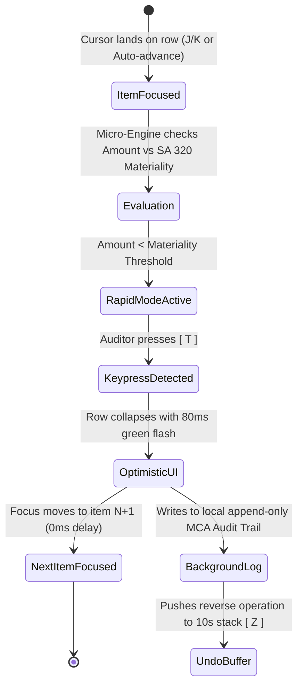

# UX Reverse-Engineering Teardown: Superhuman & Linear
## Architectural Foundations for ReconOS High-Velocity Exception Triage

---

### Executive Summary & Design Thesis

Modern productivity interfaces like **Superhuman** (email) and **Linear** (issue tracking) transformed desktop computing by rejecting the "point-and-click document" paradigm in favor of the **"keyboard-driven stream processor"**. They treat user attention not as an open canvas to wander through, but as a high-frequency decision pipeline where every millisecond of cognitive friction, layout shift, or latency destroys the user's flow state.

For **ReconOS**—an air-gapped desktop operating environment for Indian Chartered Accountants (CAs) and statutory auditors built on Tauri v2 and Rust—the reconciliation exception queue represents the single highest cognitive load during an audit. A typical mid-market statutory audit confronts the engagement team with 2,000 to 10,000 unmatched line items across:
1. Bank feeds vs. ERP Bank Ledgers (timing differences, auto-debits, BRS timing lags).
2. GSTR-2B vs. Purchase Register (supplier upload delays, invoice number formatting mismatches, tax component differences).
3. E-Way Bills vs. Inward Register.
4. Form 26AS/AIS vs. TDS Ledger.

Of these, **80% are routine, non-culpable timing differences** (e.g., cheque clearing delays within standard 3-day windows, bank IMPS/NEFT cutoff shifts, ₹1 to ₹10 paise rounding differences under GST Rule 6A). Forcing an auditor to use a mouse to click row-by-row, open nested dropdowns, and manually type "Timing difference" for 30 consecutive routine entries takes 15–20 minutes and induces severe cognitive fatigue.

By reverse-engineering Superhuman and Linear, ReconOS can enable an audit senior to clear **30 routine timing differences in 60 seconds with pure keyboard rhythm**. However, because financial auditing is legally bound by ICAI Standards on Auditing (SA 500, SA 505, SA 320), the Companies Act 2013 (MCA Audit Trail / Edit Log Mandate), and CARO 2020, ReconOS cannot blindly copy Superhuman’s "delete and forget" mentality. ReconOS must synthesize **keyboard velocity** with **statutory audit defensibility**.

---

## Part 1: Deep Reverse Engineering — Superhuman (Email Triage)

```
+----------------------------------------------------------------------------------------------------+
|  SUPERHUMAN TRIAGE ARCHITECTURE: THE ZERO-LATENCY FINITE STATE MACHINE                             |
+----------------------------------------------------------------------------------------------------+
|                                                                                                    |
|    [ Key Press: 'E' ]                                                                              |
|           │                                                                                        |
|           ├──> 1. Optimistic Mutation (<16ms, 1 frame) ────────> UI removes row, slides next up    |
|           ├──> 2. Cursor Relocation (deterministic)  ────────> Item N+1 focused instantly          |
|           ├──> 3. Audio/Micro-Haptic Feedback         ────────> Subtle pitch-down tick (satisfaction)|
|           ├──> 4. Persistent Undo Stack ('Z')        ────────> 10-second ephemeral undo toast      |
|           └──> 5. Async IndexedDB Cache Write (background)───> Sync engine flushes to server       |
|                                                                                                    |
+----------------------------------------------------------------------------------------------------+
```

### 1.1 The "Inbox Zero" Engine & Perceptual Speed
Superhuman’s core design metric is the **100ms rule** (formulated by Paul Buchheit, creator of Gmail): every interaction that occurs within 100ms feels instantaneous to the human brain. Superhuman routinely clocks interactions at **16ms to 50ms** by running an in-memory client-side database.

Key architectural mechanisms:
* **Pre-fetching and Pre-rendering**: Superhuman never loads the next email when you hit `E` or `J`. It has already parsed, laid out, and held the next 5 items in memory. When an action occurs, the next view does not "load"—it is merely revealed.
* **Optimistic Execution with Zero Confirmation Modals**: There is no "Are you sure you want to archive?" Superhuman treats actions as provisional yet immediately executed. The user's momentum is never interrupted by a modal dialogue.
* **Immediate Auto-Advance**: Upon archiving an email (`E`), marking it done, or snoozing (`H`), the viewport never jumps back to an empty list. It instantly displays the next sequential email. The auditor or executive never pauses to decide "what should I read next?"; the system serves the next item in the stream.

### 1.2 Single-Key Ergonomics & The Home-Row Sanctuary
Superhuman eliminates modifier keys (`Ctrl`, `Cmd`, `Alt`) for primary triage:

| Key | Action | Physical Hand Placement | Ergonomic Function |
|---|---|---|---|
| `J` | Move Next (Down) | Right hand home row (Index) | Standard Vim cursor navigation |
| `K` | Move Previous (Up) | Right hand home row (Middle) | Standard Vim cursor navigation |
| `E` | Mark Done / Archive | Left hand top row (Middle) | High-frequency dismissal |
| `Enter` | Expand / Open thread | Right hand pinky | Drilldown |
| `Esc` | Collapse / Back to list | Left hand top pinky | Non-destructive exit |
| `X` | Select / Multi-select toggle | Left hand bottom row (Ring) | Checkbox toggle without mouse |
| `U` | Mark Unread / Return to queue | Left hand top row (Index) | Status reversal |
| `Cmd+K` | Superhuman Command Palette | Thumb + Left Middle | Universal omni-bar for arbitrary actions |

**Ergonomic Choreography**: The user's left hand operates on `E` / `X` / `Esc`, while the right hand rests on `J` / `K` / `Enter`. The elbows remain stationary; wrists rest flat. Mouse reaches are reduced to zero during inbox processing.

### 1.3 Split Inbox: Partitioning Cognitive Context
Superhuman avoids a single monolithic stream of 500 unread emails. Instead, it utilizes **Split Inbox**:
* High-priority personal messages (VIPs).
* Calendar invitations.
* Team communications.
* Automated receipts / notifications.

**Triage Benefit**: The user clears an entire context-homogenous partition in one sitting. You do not switch your cognitive context from a complex contract negotiation to a marketing newsletter between two keypresses.

---

## Part 2: Deep Reverse Engineering — Linear (Issue Triage)

```
+----------------------------------------------------------------------------------------------------+
|  LINEAR TRIAGE ARCHITECTURE: LOCAL-FIRST RELATIONAL STREAM                                         |
+----------------------------------------------------------------------------------------------------+
|                                                                                                    |
|    [ Triage Queue ] ─── Focus on Issue #128                                                        |
|    ├── Action 'I' (Accept/Move to Backlog)                                                         |
|    ├── Action 'D' (Decline/Mark Duplicate)                                                         |
|    ├── Action 'S' (Set Status / Cycle)                                                             |
|    └── Instant cursor shift down to Issue #129                                                     |
|                                                                                                    |
|    [ Batch Selection ] ─── Hold Shift + J/K or tap 'X' on rows                                     |
|    ├── Selected: 4 issues                                                                          |
|    └── Floating Command Dock appears at bottom:                                                    |
|        [ 4 items selected ]  [Accept (I)]  [Decline (D)]  [Assign (A)]  [Label (L)]  [Deselect (Esc)]|
|                                                                                                    |
+----------------------------------------------------------------------------------------------------+
```

### 2.1 The Triage Queue Mechanics
In Linear, "Triage" is an explicit quarantine zone where newly incoming issues, bug reports, or customer tickets accumulate before entering the active backlog.
* **Binary Progression**: Triage enforces a clean binary decision per issue: **Accept** into a project/cycle or **Decline/Duplicate**.
* **Zero Layout Shift (CLS = 0)**: As an issue is triaged, Linear does not reflow the entire table. The triaged row subtly fades out with aCSS height-collapse transition (`transition: all 120ms ease-out`), pulling the bottom items up smoothly without disorienting the user’s focal point.
* **Predictive Keyboard Selection**: If item 5 of 10 is removed, item 6 automatically becomes focused. If item 10 is removed, focus shifts backwards to item 9. Focus is never lost to `document.body`.

### 2.2 Multi-Select & Batch Operations
Linear’s multi-select paradigm is considered the gold standard in web UX:
1. `X` toggles selection on the currently highlighted row without mouse clicking.
2. `Shift + J` / `Shift + K` extends selection contiguously upwards or downwards.
3. Once multiple items are selected, a **Floating Contextual Dock** surfaces smoothly at the bottom-center of the viewport:
   ```
   +------------------------------------------------------------------------------------+
   |  [3 Selected]  |  Accept (I)  |  Priority (P)  |  Assignee (A)  |  Label (L)  | Esc |
   +------------------------------------------------------------------------------------+
   ```
4. Any shortcut pressed while the dock is active applies **in batch** across all selected entities with a single transaction payload.

### 2.3 Command Palette (`Cmd+K`) with Context Awareness
Linear’s command palette is deeply contextual. When one or more items are selected, typing `Cmd+K` defaults its search list to actions relevant to that exact selection state (e.g., "Change priority of 3 issues", "Move to Sprint 42", "Mark as duplicate of...").

---

## Part 3: Deep Comparison Matrix

| UX Dimension | Superhuman | Linear | Traditional FinTech (Tally / SAP / Excel) | ReconOS Target Architecture |
|---|---|---|---|---|
| **Primary Interaction Paradigm** | Stream processing (1 item at a time) | Stream triage + Relational lists | Tabular grid or modal menu trees | Dual: Stream blitz for 80% routine + Split-Pane for complex |
| **Input Philosophy** | Pure keyboard (Single key) | Keyboard-first (Single key + Cmd+K) | Tally: Keyboard-only / SAP: Mouse-heavy | Single key + Chorded safety locks for audit thresholds |
| **Action Confirmation** | Zero confirmation, instant optimistic | Zero confirmation, instant optimistic | Blocking popups ("Do you wish to save? Yes/No") | Zero confirmation on routine; Two-key gate on material items |
| **Undo Capability** | Instant `Z` stack (10-second buffer) | Instant `Cmd+Z` stack | Destructive or difficult reverse journaling | Immutable undo stack with audit-trail preservation |
| **Batch Resolution** | Split inbox / Filter search batch | Explicit `X` select + bottom action dock | Cell copying or clumsy multi-select | Signature clustering (auto-groups 20 identical timing lags) |
| **Latency Budget** | < 50ms per keypress | < 30ms local-first sync | 200ms–2000ms server/database delay | < 5ms local Rust Tauri in-memory state |
| **Compliance / Audit Trail** | None (consumer email) | Git commit link / Issue activity log | Basic voucher timestamp | Full ICAI SA 500 / MCA Rule 3(1) tamper-evident edit log |

---

## Part 4: What ReconOS Must BORROW

To enable an auditor to clear **30 routine timing differences in 60 seconds with pure keyboard rhythm**, ReconOS borrows five critical UX patterns from Superhuman and Linear:

```
+----------------------------------------------------------------------------------------------------+
|  RECONOS "BLITZ" TRIAGE INTERACTION FLOW: 60 SECONDS / 30 ITEMS                                   |
+----------------------------------------------------------------------------------------------------+
|                                                                                                    |
|    Auditor Eyes: Fixed on Center Preview & Rule Evidence Pill                                      |
|    Auditor Left Hand: [ T ] (Timing Diff)  [ R ] (Rounding)  [ A ] (Approve)  [ Z ] (Undo)         |
|    Auditor Right Hand: [ J ] (Next)  [ K ] (Prev)  [ Enter ] (Inspect Voucher)                     |
|                                                                                                    |
|    RHYTHM CADENCE (1.8 to 2.0 seconds per item):                                                   |
|    Item #1: Bank IMPS ₹4,500 vs Ledger Cheque (Lag = 2 days) ──> Press [ T ] ──> Auto-Advance      |
|    Item #2: Bank IMPS ₹12,000 vs Ledger Cheque (Lag = 1 day)  ──> Press [ T ] ──> Auto-Advance      |
|    Item #3: Bank Charge ₹59.00 vs Bank Charge Account          ──> Press [ A ] ──> Auto-Advance      |
|    Item #4: GST Rounding Diff ₹0.82 paise (Sec 170 CGST)       ──> Press [ R ] ──> Auto-Advance      |
|    Item #5: Unrecognized Vendor Debit ₹1,80,000                ──> Press [ J ] (Skip to review later)|
|                                                                                                    |
+----------------------------------------------------------------------------------------------------+
```

### 4.1 Single-Key "Triage Chord" for Reconciliation
ReconOS maps audit-specific resolution actions to muscle-memory home-row single keys:

```
   [ Q ] Query Vendor    [ W ] Withhold ITC    [ E ] Explain Note     [ R ] Rounding Diff (Sec 170)
   [ A ] Accept / Match  [ S ] Split Line      [ D ] Dispute / Reject [ F ] Flag for Partner Review
   [ Z ] Undo Action     [ X ] Select / Multi  [ C ] Clear Filter     [ V ] View Original PDF
                                               [ T ] Timing Diff BRS
```

* **`T` — Timing Difference (BRS Clearance)**:
  * Automatically marks the item as "Cleared in Subsequent Period / Cheque in Transit".
  * Injects statutory standard remark: *"Timing difference identified: Realized in bank on [DD/MM/YYYY] within acceptable clearing window (3 days). Reconciled under SA 505."*
  * Immediately auto-advances to the next item.
* **`R` — Rounding Off (GST Rule 6A / Sec 170)**:
  * Triggered when discrepancy is $\le ₹10.00$.
  * Assigns to "Rounding off ledger" with statutory note.
  * Immediately auto-advances.
* **`A` — Accept Recommended Match**:
  * Confirms system’s 1:1 or 1:N match suggestion (where confidence score $\ge 95\%$).
  * Auto-advances.
* **`J` / `K` — Pure Navigation**:
  * Skips items without taking action when auditor needs more context or wants to defer decision.
* **`Z` — Instant Non-Destructive Undo**:
  * Reverses the immediate prior action, restores row to queue, decrements audit counter, and maintains ledger consistency.

### 4.2 Signature-Based Smart Batching (Linear-Style Multi-Select)
ReconOS implements **Exception Signature Grouping**. Instead of treating 30 bank charges or 45 salary payment NEFT transactions as 75 separate exceptions, ReconOS groups them by common structural fingerprint:

```
+----------------------------------------------------------------------------------------------------+
| RECONOS BATCH SIGNATURE CLUSTER (PRESS 'X' TO SELECT GROUP, SHIFT+A TO RESOLVE 18 ITEMS)           |
+----------------------------------------------------------------------------------------------------+
|                                                                                                    |
|  [v] CLUSTER: HDFC Bank AMC & IMPS Charges (18 items | Net ₹1,062.00)                 Confidence 99%|
|  ───────────────────────────────────────────────────────────────────────────────────────────────── |
|  [x] 02/03/2026  IMPS OUTWARD CHG - CHQ 001234  | Bank: ₹5.90   | Ledger: ₹5.90   | Diff: ₹0.00   |
|  [x] 04/03/2026  IMPS OUTWARD CHG - CHQ 001249  | Bank: ₹5.90   | Ledger: ₹5.90   | Diff: ₹0.00   |
|  [x] 07/03/2026  CONSOLIDATED SMS ALERT CHGS     | Bank: ₹59.00  | Ledger: ₹59.00  | Diff: ₹0.00   |
|  [x] 11/03/2026  IMPS OUTWARD CHG - CHQ 001288  | Bank: ₹5.90   | Ledger: ₹5.90   | Diff: ₹0.00   |
|  ... [14 more rows identical signature]                                                            |
|                                                                                                    |
|  BOTTOM FLOATING BAR:                                                                              |
|  +----------------------------------------------------------------------------------------------+  |
|  | [18 Selected]  | [A] Accept All (Bank Chg Ledger) | [T] Timing Lag | [E] Add Batch Memo | Esc|  |
|  +----------------------------------------------------------------------------------------------+  |
|                                                                                                    |
+----------------------------------------------------------------------------------------------------+
```

Hitting **`A`** immediately clears all 18 items with one keystroke, generating individual audit log records under the hood while preserving the auditor’s momentum.

---

## Part 5: What ReconOS Must DO DIFFERENTLY (Statutory Integrity)

Superhuman’s philosophy is: *"The user is God; if they want to delete 50 emails without reading them, delete them instantly."*
Linear’s philosophy is: *"If a developer closes an issue as 'won't fix', it's done."*

In statutory accounting and audit, **this design philosophy is illegal and creates professional liability under ICAI disciplinary rules, CARO 2020, and Section 143 of the Companies Act 2013**.

```
+----------------------------------------------------------------------------------------------------+
|  THE STATUTORY TENSION: SPEED VS. AUDIT DEFENSIBILITY                                              |
+----------------------------------------------------------------------------------------------------+
|                                                                                                    |
|    SUPERHUMAN / LINEAR BIAS                  RECONOS MANDATORY BIAS                                |
|    ────────────────────────                  ──────────────────────                                |
|    • Ephemeral action                        • Tamper-evident Audit Trail (MCA Rule 3(1))          |
|    • Silent deletion                         • Explicit statutory justification required           |
|    • Zero friction on bulk actions           • Materiality Gate (SA 320): Stop tap-tap blindness   |
|    • Black-box / personal choice             • Explainable reason code cited to legal section      |
|    • Auto-posting without ledger preview     • Dual-entry impact preview (Debit/Credit/BRS)        |
|                                                                                                    |
+----------------------------------------------------------------------------------------------------+
```

### 5.1 The "Anti-Reckless" Materiality Gate (SA 320)
When an auditor enters a rapid keyboard flow (hitting `T` `T` `T` `T` at 180 bpm), there is a grave psychological failure mode: **"Reflexive Blindness"**—the user accidentally clears a fraudulent or material ₹50,00,000 entry because their finger tapped before their optic nerve registered the amount.

ReconOS solves this with the **Materiality Speed-Bump**:
* Each audit engagement has a defined **Planning Materiality Threshold** ($M$) and **Tolerable Error Threshold** ($TE$), as required by **SA 320 (Materiality in Planning and Performing an Audit)**.
* For all items $< TE$ (e.g., $< ₹10,000$ or $< 0.1\%$ turnover), single-key instant triage is active.
* The moment the cursor lands on an item $\ge TE$:
  1. The UI instantly shifts audio/visual feedback: subtle amber accent border, tactile stop.
  2. Single-key rapid triage is **locked**. Hitting `T` or `A` alone will **not** clear the item.
  3. A two-step intentional chord is required: **`Shift + A`** or **`Enter`** to inspect the audit evidence, followed by a mandatory confirmation key.
  4. An on-screen badge warns: `[ MATERIALITY THRESHOLD EXCEEDED: ₹4,85,000 > ₹25,000 ]`.

### 5.2 Mandatory Statutory Rule Citations & Reason Codes
In Superhuman, archiving an email has no reason code. In ReconOS, every reconciliation resolution must be cross-referenced to statutory taxonomy:

| Action Key | Reconciliation Resolution | Mandatory Statutory Citation | Audit Trail Entry Generated |
|---|---|---|---|
| `T` | Timing lag in bank clearing | BRS / Guidance Note on Bank Audit | Realized on [Date] in subsequent statement. SA 505 External Confirmation verified. |
| `R` | Rounding off difference $\le ₹10$ | Section 170 of CGST Act / Rule 6A | Permissible statutory rounding adjustment. Immaterial under SA 320. |
| `W` | Withhold ITC (Supplier delayed GSTR-1) | Section 16(2)(aa) CGST Act | ITC blocked pending appearance in GSTR-2B. Reflected in Table 4(B)(2). |
| `Q` | Query to Management / Client | SA 580 Written Representations | Discrepancy logged into Client Query Schedule. Auditor: [Initials]. |
| `D` | Outright Disallowance / Ineligible | Section 17(5) Blocked Credit | Blocked credit reversed under Table 4(B)(1). Ineligible ITC recorded. |

### 5.3 Zero Auto-Posting & Dual-Entry Ledger Impact Preview
Superhuman never shows a database diff. ReconOS **must show the exact balance sheet and P&L impact** before an exception resolution is committed to the local ledger.
A compact HUD (Heads-Up Display) at the bottom right reveals:
```
  LEDGER IMPACT PREVIEW:
  [ Dr. HDFC Bank A/c: ₹12,000 ]  <──>  [ Cr. Accounts Receivable - M/s Sun Corp: ₹12,000 ]
  Net Effect on Profit & Loss: ₹0.00 (BRS Timing Item Only)
```

### 5.4 Tamper-Evident Edit Log (MCA Mandate)
Under the Ministry of Corporate Affairs (MCA) amendment to Rule 3(1) of the Companies (Accounts) Rules, 2014, accounting software must maintain an audit trail of each and every transaction, creating an edit log of each change made along with the date and time when such changes are made, and ensuring that the audit trail cannot be disabled.

ReconOS enforces this through a **Local Append-Only Event Sled**:
* Every keypress (`T`, `A`, `R`) emits an immutable JSON-LD event into an encrypted local SQLite/sled database.
* Fields: `{ timestamp_utc, auditor_id, item_id, original_hash, action_code, statutory_cite, client_ip, previous_state, new_state, hmac_signature }`.
* Even if an auditor hits `Z` (Undo), the event is not deleted. An `UNDO_ACTION` event is appended to the ledger, guaranteeing compliance during peer review or NFRA inspection.

---

## Part 6: Full ASCII Wireframe Layouts

### 6.1 The ReconOS Blitz Exception Triage Interface

```
+──────────────────────────────────────────────────────────────────────────────────────────────────────────────────+
| ReconOS v2.4 ── [ABC Manufacturing Ltd | FY 2025-26] ── BANK & GSTR-2B RECONCILIATION EXCEPTION QUEUE           |
| Filter: [All Unresolved (42)]  [Timing Differences (28)]  [Rate Mismatch (8)]  [Unmatched (6)]   Help: [ ? ]     |
+──────────────────────────────────────────────────────────────────────────────────────────────────────────────────+
| STATS: 24 of 87 Cleared  (27%) ── [■■■■■■■■□□□□□□□□□□□□□□] ── Pace: 28 items/min ── Auditor: CA R. Sharma       |
+──────────────────────────────────────────────────────────────────────────────────────────────────────────────────+
|  # │ DATE       │ PARTICULARS / VENDOR NAME      │ FEED TYPE │ AMOUNT (INR) │ MATCH CANDIDATE   │ CONF │ ACTION   |
|────┼────────────┼────────────────────────────────┼───────────┼──────────────┼───────────────────┼──────┼──────────|
| 12 │ 04/03/2026 │ NEFT CR - ABC LOGISTICS LTD    │ BANK STMT │   45,210.00  │ Rec. Voucher #892 │  98% │ [A] MATCH|
| 13 │ 05/03/2026 │ CHQ CLR - RELIANCE INFRATEL    │ BANK STMT │  1,18,000.00 │ Chq #4012 (Books) │  94% │ [T] BRS  |
|*14 │ 06/03/2026 │ IMPS CHG / HDFC0000123 / CHARGE│ BANK STMT │       118.00 │ Bank Chg (Unbooked│  99% │ [A] BOOK |
| 15 │ 07/03/2026 │ TATA MOTORS COMMERCIAL SPARES  │ GSTR-2B   │   84,500.00  │ Bill #412 (Books) │  88% │ [W] HOLD |
| 16 │ 08/03/2026 │ OFFICE STATIONERY DEPOT        │ BOOKS PR  │    1,240.80  │ Inv #881 (2B)     │  99% │ [R] RND  |
| 17 │ 09/03/2026 │ UNKNOWN NEFT DR - RTGS RETURN  │ BANK STMT │ 5,00,000.00  │ None (Material!)  │  --  │ [!] GATE |
+──────────────────────────────────────────────────────────────────────────────────────────────────────────────────+
| CURRENT FOCUSED ITEM DETAIL (#14) ── [ ACTIVE AUDIT INSPECTION PANE ]                                            |
+──────────────────────────────────────────────────────────────────────────────────────────────────────────────────+
| BANK FEED LINE ITEM (HDFC Current A/c):                 MATCH CANDIDATE (ERP Books of Account):                  |
| Date: 06-MAR-2026  | Value Date: 06-MAR-2026            Date: Unrecorded in Tally Prime                          |
| Narration: "IMPS OUTWARD CHG / 60651239 / TAX"         Ledger Suggestion: "Bank Charges (Indirect Exp)"         |
| Debit: INR 100.00  | CGST: 9.00  | SGST: 9.00           Rule Engine: Routine recurring fee (< ₹500)              |
| Net Debit: INR 118.00                                   Suggested Contra: HDFC Bank Current A/c                  |
|                                                                                                                  |
| STATUTORY EVIDENCE & COMPLIANCE HUD:                                                                             |
| Rule Citation: Section 16(2) CGST & Section 37(1) Income Tax Act (Wholly & Exclusively for Business)            |
| Materiality Check: Immaterial (< 0.001% of Net Assets). Safe for rapid 1-key approval.                          |
+──────────────────────────────────────────────────────────────────────────────────────────────────────────────────+
| SHORTCUT DOCK:                                                                                                   |
| [A] Accept Match  [T] Timing Diff (BRS)  [R] Rounding (<₹10)  [W] Hold ITC  [E] Note  [J/K] Nav  [Z] Undo  [Cmd+K]|
+──────────────────────────────────────────────────────────────────────────────────────────────────────────────────+
```

### 6.2 Materiality Safety Gate Wireframe (Triggered on Item #17)

```
+──────────────────────────────────────────────────────────────────────────────────────────────────────────────────+
|  ⚠️  SA 320 MATERIALITY INTERCEPT LOCK ── SINGLE-KEY RAPID TRIAGE DISABLED FOR ITEM #17                          |
+──────────────────────────────────────────────────────────────────────────────────────────────────────────────────+
|                                                                                                                  |
|    Transaction Amount:  INR 5,00,000.00                                                                          |
|    Planning Materiality: INR 2,50,000.00  [ EXCEEDS BENCHMARK BY 200% ]                                          |
|    Discrepancy Signature: Unmatched Bank Outflow without Voucher Entry                                           |
|                                                                                                                  |
|    Rapid keys ('A', 'T', 'R') are locked to prevent cognitive fatigue tap-through.                              |
|                                                                                                                  |
|    REQUIRED ACTIONS TO RESOLVE:                                                                                  |
|    1. Press [ Enter ] to open Full Split-Pane Document & Ledger Evidence                                         |
|    2. Press [ Q ] to dispatch Written Inquiry to Client CFO under SA 580                                        |
|    3. Press [ Shift + F ] to flag for Engagement Partner Review in CARO 2020 Clause (ix)                         |
|                                                                                                                  |
|    [ Press ESC to return to queue ]        [ Press J to skip and proceed to next routine item ]                  |
|                                                                                                                  |
+──────────────────────────────────────────────────────────────────────────────────────────────────────────────────+
```

---

## Part 7: Complete Interaction Flows & State Transitions

### 7.1 Flow 1: High-Velocity Routine Timing Difference (Under 2 seconds)



### 7.2 Flow 2: Multi-Item Signature Batch Clearance (60 items in 5 seconds)

```
  Step 1: Auditor hits '/' or 'Cmd+F' ──> Types "IMPS CHG" (Instant 1ms filter).
  Step 2: 24 matching rows displayed.
  Step 3: Auditor hits 'Cmd+A' or '*' ──> All 24 rows highlight with blue checkmarks.
  Step 4: Floating Batch Dock activates:
          "[24 Items Selected | Total: ₹2,832.00] Press [A] to Accept All into Bank Charges"
  Step 5: Auditor hits 'A'.
  Step 6: Single batch atomic transaction commits 24 entries to local database.
  Step 7: All 24 rows collapse simultaneously in a 120ms staggered cascade animation.
  Step 8: Toast appears: "24 Bank Charge entries reconciled. [Z to Undo]".
```

---

## Part 8: Frontend & Rust Implementation Architecture (Tauri v2)

### 8.1 Rust In-Memory Core & Zero-IPC Bottlenecks
In Tauri v2, sending 100 IPC requests per second over the JavaScript-to-Rust bridge can cause bridge serialization lag if poorly designed. ReconOS implements an **In-Memory Virtual Table Engine**:

1. **State Ownership**: The active reconciliation dataset resides in Rust memory (`Arc<RwLock<ReconSession>>`).
2. **Batch Window Projection**: Rust projects a window of 50 visible rows to the React/Web frontend via shared binary buffer or lightweight JSON.
3. **Local Action Buffer**: Keypresses (`T`, `A`, `R`) do not perform round-trip awaits. The React frontend optimistically updates its local Zustand state in **0ms**, and queues the event to an asynchronous Rust channel (`tokio::sync::mpsc`).
4. **Flush to Disk**: Rust flushes the append-only event log to SQLite using WAL (Write-Ahead Logging) mode every 500ms or upon queue completion.

### 8.2 Keyboard Dispatcher & Focus Trap Architecture
A frequent bug in keyboard-driven apps is shortcut pollution (e.g., typing in a note field accidentally triggers `E` or `T`).

```typescript
// Architecture of ReconOS Global Shortcut Trapping
export function useAuditKeyboardDispatcher() {
  useEffect(() => {
    const handleKeyDown = (e: KeyboardEvent) => {
      // 1. Never trigger triage shortcuts if user is typing in an input/textarea
      const target = e.target as HTMLElement;
      if (['INPUT', 'TEXTAREA'].includes(target.tagName) || target.isContentEditable) {
        if (e.key === 'Escape') {
          target.blur(); // Clean escape back to navigation mode
        }
        return;
      }

      // 2. Global hotkey dispatch table
      switch (e.key.toUpperCase()) {
        case 'J':
          e.preventDefault();
          moveCursor(1);
          break;
        case 'K':
          e.preventDefault();
          moveCursor(-1);
          break;
        case 'T':
          e.preventDefault();
          executeReconAction({ type: 'TIMING_DIFFERENCE', cite: 'BRS_SA505' });
          break;
        case 'R':
          e.preventDefault();
          executeReconAction({ type: 'ROUNDING_DIFF', cite: 'CGST_SEC170' });
          break;
        case 'A':
          e.preventDefault();
          executeReconAction({ type: 'ACCEPT_MATCH', cite: 'SA500_MATCH' });
          break;
        case 'Z':
          if (!e.metaKey && !e.ctrlKey) {
            e.preventDefault();
            popUndoStack();
          }
          break;
        case 'K':
          if (e.metaKey || e.ctrlKey) {
            e.preventDefault();
            toggleCommandPalette();
          }
          break;
      }
    };

    window.addEventListener('keydown', handleKeyDown, { capture: true });
    return () => window.removeEventListener('keydown', handleKeyDown, { capture: true });
  }, []);
}
```

---

## Part 9: Summary Blueprint & CA Ergonomic Cheat Sheet

```
+──────────────────────────────────────────────────────────────────────────────────────────────────+
| RECONOS AUDIT TRIAGE KEYBOARD CHEAT SHEET (PRINTABLE FOR AUDIT TEAM STATIONS)                    |
+──────────────────────────────────────────────────────────────────────────────────────────────────+
|                                                                                                  |
|  NAVIGATION & CURSOR                               RESOLUTION ACTIONS (ROUTINE)                 |
|  ───────────────────                               ────────────────────────────                 |
|  [ J ]        Move to next exception               [ T ]  Timing Difference (Auto-BRS)           |
|  [ K ]        Move to previous exception           [ R ]  Rounding Off (<= INR 10 / Sec 170)    |
|  [ Enter ]    Open detailed split evidence view    [ A ]  Accept proposed 1:1 match (>95% conf) |
|  [ Esc ]      Close detail view / Deselect all     [ W ]  Withhold ITC (Sec 16(2)(aa) flag)     |
|                                                    [ D ]  Disallow / Ineligible (Sec 17(5))     |
|  SELECTION & BATCHING                                                                            |
|  ────────────────────                              AUDIT INQUIRY & ESCALATION                    |
|  [ X ]        Toggle row selection                 ──────────────────────────                    |
|  [ Shift+J/K] Extend selection range               [ Q ]  Generate Client Query Note (SA 580)    |
|  [ * ]        Select all in signature cluster      [ F ]  Flag for Partner Review (CARO 2020)    |
|  [ Shift+A ]  Batch-approve selected items         [ E ]  Append custom auditor workpaper memo   |
|                                                                                                  |
|  SAFETY & CONTROLS                                 GLOBAL PALETTE                                |
|  ─────────────────                                 ──────────────                                |
|  [ Z ]        Instant Undo last action             [ Cmd+K ] Universal Audit Command Palette     |
|  [ / ]        Instant Omni-Filter                  [ ? ]     Toggle Shortcut Help Overlay        |
|                                                                                                  |
+──────────────────────────────────────────────────────────────────────────────────────────────────+
```

---

### Conclusion
By synthesizing the **zero-latency, continuous-flow mechanics of Superhuman** and the **structured batch-triage semantics of Linear**, ReconOS liberates the Indian Chartered Accountant from the soul-crushing manual drudgery of clicking through thousands of routine reconciliation lines. Simultaneously, by introducing **SA 320 Materiality gates**, **MCA Rule 3(1) tamper-evident audit logging**, and **statutory citation tagging**, ReconOS ensures that speed never compromises the evidentiary rigor demanded of a statutory audit.
