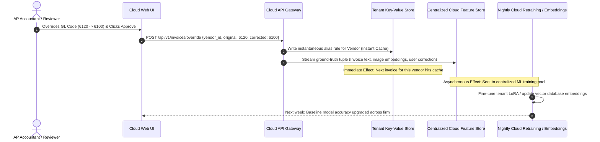
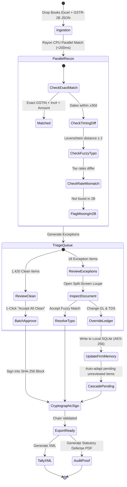

# UX Reverse-Engineering Teardown: Vic.ai & Docyt vs. ReconOS
**Deep Architectural & Interaction Teardown of AI-Powered Autonomous AP/Accounting Engines**
*Prepared for the ReconOS Core Engineering Team (Chirag, Rajveer, Vihaan)*
*Date: November 2026 | Focus: Air-Gapped Financial Intelligence, Statutory Defense & Local-First UX*

---

## Executive Summary & Architectural Comparison

Modern autonomous accounting platforms like **Vic.ai** and **Docyt** have fundamentally redefined Enterprise Accounts Payable (AP) by shifting the user paradigm from **data entry** to **exception management**. However, both platforms are architected as centralized cloud SaaS engines designed for US/European enterprise ERPs (NetSuite, Workday, SAP, QuickBooks). When applied to the high-stakes, heavily regulated world of Indian Chartered Accountants (CAs), statutory tax audits, and strict ICAI confidentiality mandates, their architectural assumptions collapse.

This teardown deconstructs the UX mechanics of Vic.ai and Docyt across four dimensions:
1. **Confidence Score Visualization**
2. **AI Suggestion & Anomaly Presentation**
3. **Human-in-the-Loop (HITL) Sign-Off & Feedback Loops**
4. **Strategic Architectural Translation for ReconOS**

### Core Architectural Matrix

| Dimension | Vic.ai (Enterprise Cloud AP) | Docyt (SMB & Franchise Accounting) | ReconOS (CA Audit Cockpit) |
| :--- | :--- | :--- | :--- |
| **Primary Mental Model** | "Autopilot AP Robot" with supervisory human review | "Virtual Back-Office AI" for real-time bookkeeping | "Air-Gapped Audit Defense Cockpit" for CAs |
| **Target User** | Corporate AP Clerks & Shared Services Centers | Franchise owners, SMB bookkeepers, outsourced CPAs | Chartered Accountants, Tax Auditors, Article Assistants |
| **Core Workflow** | Invoice ingestion -> Cloud OCR/ML -> Autopost | Continuous reconciliation (POS/PMS -> Bank -> GL) | 3-Way Recon (Books vs GSTR-2B vs Bank Feed) |
| **Deployment Model** | 100% Cloud Multi-tenant (AWS/GCP) | 100% Cloud Multi-tenant (AWS) | **100% Local-First Desktop (Tauri v2 + Rust)** |
| **Network Footprint** | Heavy bi-directional cloud streaming | Continuous cloud API sync | **0 KB Outbound (Strictly Air-Gapped)** |
| **Confidence Scoring** | Probabilistic float (0.00 – 1.00), color tiers | Binary thresholds ("Auto-categorized" vs "Review") | **Deterministic Statutory Citation + Rule Certainty** |
| **Decision Defense** | Black-box ML prediction (No statutory backing) | Heuristic + historical pattern match | **Statutory Sections (CGST Sec 16, TDS Sec 194Q/J)** |
| **Learning Engine** | Cloud retraining pipeline on centralized telemetry | Cloud tenant rules + embedding updates | **Encrypted Local SQLite Firm Memory (`ring` AES-GCM)** |
| **Sign-Off Integrity** | Standard DB audit timestamp in cloud | Activity log in cloud database | **Cryptographic SHA-256 Hash Chain (`AuditBlock`)** |
| **ERP Target** | NetSuite, SAP, Workday, Microsoft Dynamics | QuickBooks Online, Xero | **Tally Prime (`<TALLYMESSAGE>` XML) & Busy** |

---

## 1. How AI Confidence Scores Are Visually Represented

### 1.1 Vic.ai: The 3-Tier Granular Traffic Light System

Vic.ai scores every extracted header field (Vendor Name, Invoice #, Invoice Date, Total Amount, Due Date) and every line-item GL coding prediction on a continuous mathematical scale from `0.00` to `1.00` (in increments of 0.01).

```
   [ 0.00 -------------- 0.39 ]   [ 0.40 -------------- 0.79 ]   [ 0.80 -------------- 1.00 ]
             RED TIER                        AMBER TIER                       GREEN TIER
          Low Confidence                 Moderate Confidence                High Confidence
     Mandatory Human Review             Quick Visual Spot-Check          Autopilot Eligible
```

#### Visual Anatomy of Vic.ai Field Scores:
- **Green Tier (> 0.80):** Rendered with a subtle green border, an emerald confidence chip (e.g., `96%`), and a closed green checkmark. If all mandatory fields and line allocations exceed the client's configured *Autopilot Threshold* (typically 85% to 95%), the invoice completely bypasses human queues and posts straight-through.
- **Amber Tier (0.40 – 0.79):** Rendered with a muted yellow/amber badge and a warning glyph (`⚠️ 64%`). The UI auto-focuses the field when the user opens the document.
- **Red Tier (< 0.40):** Rendered with a solid rose-red pill, high-contrast text (`❗ 32%`), and a pulsing outline. The field cannot be approved without an explicit keypress or manual confirmation.

```
+----------------------------------------------------------------------------------------------------+
| VIC.AI FIELD-LEVEL CONFIDENCE ANATOMY                                                               |
+----------------------------------------------------------------------------------------------------+
|                                                                                                    |
|  [HIGH CONFIDENCE - GREEN (>0.80)]                                                                 |
|  Vendor Name:   [ Adobe Systems Inc.           | 98% (•) ]  <-- Bypasses human touch in Autopilot  |
|                                                                                                    |
|  [MEDIUM CONFIDENCE - AMBER (0.40-0.79)]                                                           |
|  GL Account:    [ 6120 - Cloud Subscriptions   | 68% (▲) ]  <-- Amber highlight, top-3 dropdown     |
|                                                                                                    |
|  [LOW CONFIDENCE - RED (<0.40)]                                                                    |
|  Tax Code:      [ CA_STATE_TAX_EXEMPT          | 31% (!) ]  <-- Hard stop; requires explicit override|
+----------------------------------------------------------------------------------------------------+
```

#### Synchronized Canvas Loupe & Bounding Boxes:
- In Vic.ai, the document viewer sits side-by-side with the extraction pane.
- Clicking or `Tab`-navigating to any extracted field immediately fires an SVG viewport animation that pans and zooms the original PDF to the exact coordinates (`x, y, w, h`) of the extracted value.
- The bounding box on the PDF canvas is color-matched to the confidence tier:
  - Green box for >80%
  - Amber box for 40–80%
  - Red box for <40%

---

### 1.2 Docyt: Workflow Status & Out-of-Pattern Thresholds

Docyt avoids exposing raw decimals (like `0.73`) across everyday screens. Instead, it translates model certainty into **operational states**:

```
+----------------------------------------------------------------------------------------------------+
| DOCYT WORKFLOW STATUS TRIAGE                                                                       |
+----------------------------------------------------------------------------------------------------+
|                                                                                                    |
|  [AUTO-CATEGORIZED]          [NEEDS ATTENTION]             [OUT-OF-PATTERN ANOMALY]                |
|  High certainty baseline.    Ambiguous vendor or           Variance flag: P&L trend spike or       |
|  Silently reconciles.        first-time invoice.           duplicate detected.                     |
|  Status: [ Cleared ✓ ]       Status: [ Review Queue ⚠️ ]   Status: [ Discrepancy Flag ⚡ ]          |
+----------------------------------------------------------------------------------------------------+
```

- **Clean Transactions:** Disappear from active view into a "Reconciled" tab.
- **Ambiguous Transactions:** Filtered into the "Open Items / Review Queue" with a card-based layout highlighting the exact source of friction (e.g., *"Unrecognized Vendor: CleanCorp"*, *"Amount mismatch with Bank Deposit by $14.20"*).
- **Metric Variance:** Docyt pairs confidence with statistical variance indicators, showing whether an expense is within normal standard deviations (e.g., `+18% above 3-mo average`).

---

## 2. How AI Suggestions Are Presented

### 2.1 Ledger Head Proposals (GL Coding)

#### Vic.ai's Top-3 Ranked Candidate Table:
When an invoice line item requires a General Ledger account, Vic.ai renders a combobox that exposes its top three probabilistic candidates, accompanied by relative probability bars and keyboard shortcuts.

```
+----------------------------------------------------------------------------------------------------+
| VIC.AI GL CODING PROPOSAL DROPDOWN                                                                 |
+----------------------------------------------------------------------------------------------------+
| Line Item 1: "Annual Creative Cloud License"                                    Amount: $1,199.88  |
|                                                                                                    |
| Active GL Field: [ 6100 - Software & SaaS               | 87% Conf. ] [⌄]                          |
| +------------------------------------------------------------------------------------------------+ |
| | Suggested Account                           | Score  | Rationale                     | Key     | |
| |---------------------------------------------|--------|-------------------------------|---------| |
| | [*] 6100 - Software & SaaS Subscriptions    |  87%   | Vendor default (12 historical)| [Enter] | |
| | [ ] 6120 - IT & Computer Consumables        |  11%   | Co-occurring keyword 'Cloud'  | [Alt+2] | |
| | [ ] 6990 - Suspense / Unallocated Expense   |   2%   | Fallback                      | [Alt+3] | |
| |---------------------------------------------|--------|-------------------------------|---------| |
| | [Type to search entire Chart of Accounts...]                                                   | |
| +------------------------------------------------------------------------------------------------+ |
+----------------------------------------------------------------------------------------------------+
```

#### Cascading Grouped Allocations:
For multi-line invoices (e.g., an 8-page invoice with 45 line items from an industrial supplier), Vic.ai automatically clusters items sharing identical descriptions or tax rates into "Groupings". When an auditor overrides the GL code on the parent group header, the change **cascades instantaneously** across all nested items.

---

### 2.2 Tax Code Assignments

- **Vic.ai Approach:** Matches extracted tax amounts against the organization's ERP tax schedule. If the extracted tax matches the mathematical calculation (`Taxable Value * Tax Rate = Tax Amount`), it assigns the tax code with a green chip. If there is a rounding discrepancy (> $0.05) or conflicting rates across lines, it surfaces an inline split warning:
  ```
  [ Tax Discrepancy: Extracted $18.50 != Calculated $18.00 (10% on $180.00). Difference: +$0.50 ]
  ```
- **Docyt Approach:** Uses business entity rules. For hospitality and multi-unit franchises, Docyt pre-configures municipal occupancy tax and sales tax rules. When receipts or PMS payout reports arrive, tax is parsed into dedicated liability buckets automatically.

---

### 2.3 Anomaly Alerts

Both systems treat anomaly detection as a specialized UI layer distinct from routine confidence scoring:

```
+----------------------------------------------------------------------------------------------------+
| ANOMALY ALERT MODES IN VIC.AI & DOCYT                                                              |
+----------------------------------------------------------------------------------------------------+
|                                                                                                    |
|  1. DUPLICATE INVOICE DETECTION (Side-by-Side Modal)                                               |
|  +-------------------------------------+-------------------------------------+                    |
|  | CURRENT INVOICE (Pending)           | EXISTING RECORD IN SYSTEM (Posted)  |                    |
|  | Vendor: Apex Logistics              | Vendor: Apex Logistics              |                    |
|  | Inv #:  INV-2026-904                | Inv #:  INV-2026-904                |                    |
|  | Amount: $4,500.00                   | Amount: $4,500.00                   |                    |
|  | Date:   14-Oct-2026                 | Date:   12-Oct-2026                 |                    |
|  | PDF:    [View Current Scan]         | PDF:    [View Original Voucher]     |                    |
|  +-------------------------------------+-------------------------------------+                    |
|  | CRITICAL WARNING: Potential Duplicate Payment. Posted in Voucher #V-8912 on 15-Oct-2026.       |
|  | Actions: [ Merge as Copy ]  [ Mark Void / Reject ]  [ Force Post Anyway ]                       |
|  +------------------------------------------------------------------------------------------------+
|                                                                                                    |
|  2. P&L HISTORICAL VARIANCE ALERT (Docyt Trend Micro-Chart)                                        |
|  +------------------------------------------------------------------------------------------------+
|  | Vendor: Sysco Foods | Account: Food & Beverage Supplies                                         |
|  | Current Bill: $12,450.00  | 6-Month Rolling Average: $8,100.00 (Variance: +53.7%)              |
|  | [ Jan: $7.9k ] [ Feb: $8.2k ] [ Mar: $8.0k ] [ Current: $12.45k █ ]                            |
|  | ALERT: Current bill exceeds historical 2-sigma threshold. Verify price increase or quantity.   |
|  +------------------------------------------------------------------------------------------------+
+----------------------------------------------------------------------------------------------------+
```

---

## 3. Human-in-the-Loop Sign-Off & Feedback Loops

### 3.1 Review & Sign-Off Interaction Mechanics

Both systems recognize that enterprise AP accountants will not tolerate slow, mouse-heavy interfaces. Their interaction design is optimized for heads-down, high-volume review:

| Interaction Step | Vic.ai Implementation | Docyt Implementation |
| :--- | :--- | :--- |
| **Queue Filtering** | Exception-first tabs: "Autopilot Cleared", "To Review", "Duplicates", "Missing Info". | "Action Items" inbox sorted by financial urgency (due date / discount deadline). |
| **Navigation** | Full keyboard support: `Tab` to next exception, `Shift+Tab` to previous, `J`/`K` for line items. | Mouse-driven card clicks with slide-out right drawer inspector. |
| **Confirmation** | `Cmd+Enter` (Mac) or `Ctrl+Enter` (Win) to approve and immediately advance to the next invoice. | Click "Approve & Next" button or batch select from grid. |
| **Override Flow** | `Cmd+K` opens fuzzy COA search; typing filters 5,000 accounts in <50ms. | Inline dropdown with search bar. |
| **Batch Actions** | "Select all Green" -> "Batch Approve 38 Invoices". | "Select all Cleared" -> "Mark Reconciled". |

---

### 3.2 The Cloud Learning Feedback Loop (How They Learn)

When an accountant overrides an AI suggestion in Vic.ai or Docyt, an automated feedback loop is triggered:



### 3.3 The Hidden Failure Modes of the Cloud Feedback Loop

While powerful for generic corporate SaaS, this cloud feedback mechanism exhibits critical flaws when evaluated for professional audit standards:

1. **Confidentiality Violation (ICAI Code of Ethics Hazard):**
   - In Vic.ai and Docyt, client invoices, bank details, and PAN/Tax IDs are transmitted to third-party cloud infrastructure (often processed via multi-tenant LLM APIs).
   - In India, under the Chartered Accountants Act, 1949 (Second Schedule, Part I, Clause 1), a CA who discloses confidential client information without explicit consent is guilty of professional misconduct.
2. **Model Drift & Unpredictable Regressions:**
   - Because cloud models retrain continuously on global or tenant-wide data, an override made for one division can unpredictably degrade classification accuracy for another division next month.
3. **No Statutory Legal Standing:**
   - If an Indian tax officer audits a company under **Section 148** or demands proof of Input Tax Credit (ITC) under **Section 16(2)(aa)**, the CA cannot argue: *"Our cloud AI was 94% confident."* The officer requires statutory citations, filing date stamps, and deterministic verification against the government GSTR-2B portal.

---

## 4. What ReconOS Should Borrow vs. What It Must Do Differently

ReconOS is not another generic AP automation SaaS. It is an **Air-Gapped Autonomous Financial Intelligence & Audit Defense Cockpit** built specifically for Indian Chartered Accountants, running locally on Windows via **Tauri v2 + Rust**.

```
+----------------------------------------------------------------------------------------------------+
| ARCHITECTURAL PHILOSOPHY: VIC.AI vs. RECONOS                                                        |
+----------------------------------------------------------------------------------------------------+
|                                                                                                    |
|  [ VIC.AI / DOCYT CLOUD AP ]                   [ RECONOS AIR-GAPPED COCKPIT ]                      |
|  • "Trust our 96% AI confidence"               • "Here is the exact Section 16(2)(aa) legal proof"  |
|  • Multi-tenant cloud servers                  • 100% on-device (0 KB network outbound)            |
|  • Black-box vector weights                    • Deterministic rulebook + Local GGUF/Candle model   |
|  • Cloud database audit log                    • Cryptographic SHA-256 Hash Chain                   |
|  • NetSuite / Workday target                   • Tally Prime Native XML (<TALLYMESSAGE>)            |
+----------------------------------------------------------------------------------------------------+
```

### 4.1 What ReconOS Must BORROW from Vic.ai and Docyt

1. **The Exception-First Cockpit Mental Model:**
   - Never force a CA or audit associate to look at 20,000 clean, matched rows.
   - Clean matches (Exact GSTIN + Exact Invoice # + Exact Tax within ₹1 tolerance) are automatically staged for 1-click batch acceptance.
   - The user interface is 100% focused on resolving exceptions grouped by legal root cause.
2. **The 3-Pane Split-Screen Ergonomics:**
   - **Pane 1 (Left Navigation):** Client switchboard, filing period (FY 2025-26), and Exception Queues categorized by failure type.
   - **Pane 2 (Center Workspace):** Two-column reconciliation table (Books vs GSTR-2B) with keyboard navigation.
   - **Pane 3 (Right Inspector):** Synchronized visual PDF loupe with bounding boxes, ledger selector, and statutory citation card.
3. **Top-3 Ledger Candidate Ranking with Keyboard Triggers:**
   - When encountering an unmapped vendor, surface the top 3 likely ledger heads (e.g., `[1] Printing & Stationery`, `[2] Office Expenses`, `[3] Computer Expenses`) accessible via `Alt+1`, `Alt+2`, `Alt+3`.
4. **Cascading In-Session Batch Adaptation:**
   - When the CA overrides a vendor's ledger head or TDS section for one invoice, the engine must immediately scan all remaining unreviewed invoices in the current batch and update matching vendors with an explicit tag: `[Adapted to Firm Memory]`.

---

### 4.2 What ReconOS Must DO DIFFERENTLY (Core USPs)

#### 1. Deterministic Statutory Rule Citations vs. Black-Box Probabilities
- **The Problem:** Vic.ai's `94% Confidence` has zero legal evidentiary value in an Indian tax scrutiny or audit defense.
- **The ReconOS Solution:** Every single match, mismatch, or warning is paired with an explicit, dated statutory citation from the **CGST Act, 2017** or **Income Tax Act, 1961**.

```
+----------------------------------------------------------------------------------------------------+
| BLACK-BOX AI vs. RECONOS STATUTORY DEFENSE CARD                                                    |
+----------------------------------------------------------------------------------------------------+
|                                                                                                    |
|  [VIC.AI BLACK-BOX SCORE]                                                                          |
|  Status: [ AI Confidence: 91% ]                                                                    |
|  Explanation: "Model categorized this under Advertising based on vendor text."                     |
|                                                                                                    |
|  [RECONOS DETERMINISTIC STATUTORY CITATION]                                                        |
|  Status: [ STATUTORY RISK: ITC INELIGIBLE ⚠️ ]                                                      |
|  Statutory Citation: Section 16(2)(aa) CGST Act, 2017 read with Rule 36(4)                        |
|  Filing Stamp: GSTR-2B Generated: 12-Nov-2026 | Supplier GSTR-1 Filed: NOT FILED                   |
|  Audit Defense Rationale:                                                                          |
|  "Vendor has booked ₹18,000 IGST in Tally Books (Voucher #P-412), but invoice is MISSING in GSTR-2B |
|  as of 30th Nov cutoff. Availing ITC violates Sec 16(2)(aa); potential 18% p.a. interest liability|
|  under Section 50(3) if availed. Action: Reverse ITC or mark in Provisional Escrow."               |
+----------------------------------------------------------------------------------------------------+
```

#### 2. Local-First On-Device Firm Memory vs. Cloud Telemetry
- **The Problem:** Transmitting client bank books and invoices to the cloud violates ICAI client confidentiality guidelines and creates enterprise data leakage risks.
- **The ReconOS Solution:**
  - Zero cloud calls (`0 KB outbound`).
  - Learning is executed **100% on-device** using an encrypted local SQLite database (`rusqlite` + `ring` AES-GCM-256).
  - Multi-tier hierarchy:
    - **Global CA Practice Defaults:** Standard Indian Chart of Accounts (e.g., "Electricity -> Indirect Expenses", "Audit Fees -> Legal & Professional").
    - **Firm-Specific Memory:** Learned firm conventions (e.g., "This CA firm always books Google Workspace under 'Software Subscriptions' and applies TDS Sec 194J at 2%").
    - **Client-Specific Overrides:** Rules specific to a particular corporate client's accounting manual.
  - Transparent & Inspectable: CAs can open the **Firm Memory Manager**, view all learned rules, edit them, or wipe them with one click.

#### 3. Tamper-Evident SHA-256 Hash Chained Audit Trail
- **The Problem:** In standard AP tools, database logs are mutable rows in a cloud SQL table that can be edited by database administrators.
- **The ReconOS Solution:**
  - Every batch approval, manual ledger override, and statutory sign-off creates an immutable **AuditBlock** cryptographically linked to the previous block via `SHA-256`.
  - Generates a court-ready, audit-defensible verification certificate:

```
  +------------------+         +------------------+         +------------------+
  |   Block #104     |         |   Block #105     |         |   Block #106     |
  | Prev: 8f9b...12c | ------> | Prev: 4a2e...99f | ------> | Prev: d71b...34a |
  | Actor: Senior CA |         | Actor: Partner   |         | Actor: Article   |
  | Action: OVERRIDE |         | Action: BATCH_OK |         | Action: EXPORT   |
  | Hash: 4a2e...99f |         | Hash: d71b...34a |         | Hash: e830...b52 |
  +------------------+         +------------------+         +------------------+
```

#### 4. Native Indian Statutory & ERP Ecosystem Support
- **TDS Compliance Rules:** Automatic detection of thresholds under Section 194C (Contracts: 1%/2%), Section 194J (Professional fees: 2%/10%), Section 194Q (Purchase of goods > ₹50 Lakhs @ 0.1%), and Section 206C(1H) (TCS).
- **Tally Prime Direct Export:** 1-Click export of valid `<TALLYMESSAGE>` XML ready for instant import into Tally Prime via Alt+O -> Import -> Transactions, with zero manual re-entry.

---

## 5. High-Fidelity Wireframes & UI Specifications

### 5.1 Main 3-Pane Audit Cockpit Layout

```
+========================================================================================================================+
| ReconOS v1.0.4  [Client: ACME MFG PVT LTD | GSTIN: 27AABCA1234F1Z5 | Period: OCT 2026]        [🔒 0 KB Outbound] [_][口][X]|
+========================================================================================================================+
| PANE 1: WORKLISTS & EXCEPTIONS   | PANE 2: RECONCILIATION TABLE (Center)             | PANE 3: INSPECTOR & STATUTORY PROOF     |
|----------------------------------+---------------------------------------------------+-----------------------------------------|
| ▼ ACTIVE FILING (OCT 2026)       | [Filter: All] [Exceptions Only (18)] [Search Q..] | SELECTED RECORD: REC-2026-1049          |
|   • Overview & Summary           |---------------------------------------------------| Status: [ ⚠️ RATE MISMATCH ]            |
|   • Exact Matches      (1,420) ✓ | STATUS | VENDOR NAME       | INV #     | DIFF    | Rationale: Books: 12% vs GSTR-2B: 18%   |
|   ------------------------------ |--------+-------------------+-----------+---------|-----------------------------------------|
| ▼ EXCEPTION QUEUE (18)           | [❗]    | Reliance Jio      | JIO/8821  | +₹1,440 | DOCUMENT COMPARISON:                    |
|   • Timing Diff (±30d)     (6) ⏱ | [⏱]    | Tata Consultancy  | TCS/1049  |    ₹0   | BOOKS (Tally)        | GSTR-2B PORTAL   |
|   • Rate Mismatch          (3) ⚡ | [⚡]    | Godrej Industries | G-99210   |   -₹320 | Date: 12-Oct-2026    | Date: 14-Oct-2026|
|   • Invoice Typo (/ vs -)  (4) 🔤 | [🔤]    | Infosys BPM Ltd   | INF-49102 |    ₹0   | Inv#: JIO/8821       | Inv#: JIO-8821   |
|   • Missing in 2B [16(2)]  (3) 🚫 | [🚫]    | Kirloskar Tools   | KT-0012   | +₹8,200 | Taxable: ₹12,000.00  | Taxable: ₹12,000 |
|   • Unmapped Ledger        (2) ❓ | [❓]    | Zenith Graphics   | ZG/771    |    ₹0   | CGST: ₹720.00 (6%)   | CGST: ₹1,080(9%) |
|                                  |        |                   |           |         | SGST: ₹720.00 (6%)   | SGST: ₹1,080(9%) |
| ▼ AUDIT & DEFENSE                |        |                   |           |         | Total: ₹13,440.00    | Total: ₹14,160   |
|   • SHA-256 Hash Trail (Block#88)|        |                   |           |         |-----------------------------------------|
|   • Firm Memory Manager (41 rules|        |                   |           |         | STATUTORY CITATION & DEFENSE:           |
|   • Export Tally XML Voucher     |        |                   |           |         | [📜 Sec 16(2)(aa) CGST Act, 2017]       |
|                                  |        |                   |           |         | "ITC claimed exceeds GSTR-2B tax rate.  |
|                                  |        |                   |           |         | Risk: ₹720 excess credit ineligible.   |
|                                  |        |                   |           |         | Suggested: Book at 18% or dispute."     |
|                                  |        |                   |           |         |-----------------------------------------|
|                                  |        |                   |           |         | LEDGER ALLOCATION (Firm Memory):        |
|                                  |        |                   |           |         | Head: [ Internet & Telecom Exp    | ⌄ ] |
|                                  |        |                   |           |         | TDS:  [ None                      | ⌄ ] |
|                                  |        |                   |           |         |-----------------------------------------|
|                                  |        |                   |           |         | [ Accept & Adjust Books ]  [ Override ] |
+----------------------------------+---------------------------------------------------+-----------------------------------------+
| KEYBOARD: [↑/↓] Navigate | [Space] Select | [Enter] Open Inspector | [A] Approve Match | [O] Override | [Ctrl+E] Export Tally   |
+========================================================================================================================+
```

---

### 5.2 Exception Resolution & Firm Memory Adaptation Drawer

When a CA overrides a vendor ledger or resolves an exception, ReconOS opens an interactive slide-over drawer that provides instant visibility into the **local learning cascade**:

```
+====================================================================================================+
| EXCEPTION RESOLUTION: Zenith Graphics (INV #ZG/771)                                            [X] |
+====================================================================================================+
|                                                                                                    |
|  1. IDENTIFIED ISSUE:                                                                              |
|     First-time vendor. No ledger head or TDS section mapped in Tally Chart of Accounts.            |
|                                                                                                    |
|  2. SUGGESTED LEDGER HEADS (Derived from Firm Memory & Contextual Rules):                          |
|     (•) [Alt+1] 4120 - Printing & Stationery            [91% Firm Confidence]                      |
|     ( ) [Alt+2] 4150 - Advertising & Marketing          [ 7% Alternate ]                           |
|     ( ) [Alt+3] 5010 - Office Miscellaneous Expenses    [ 2% Alternate ]                           |
|     [ Other: Search Chart of Accounts...                                            ]              |
|                                                                                                    |
|  3. STATUTORY TDS WITHHOLDING SECTION:                                                             |
|     [•] Section 194C (Contractor - Advertising/Printing @ 2% for Corporate)                        |
|     [ ] Section 194J (Professional / Technical Fees @ 10%)                                         |
|     [ ] None / Below Statutory Exemption Limit (Single bill < ₹30k / Aggregate < ₹1 Lakh)          |
|                                                                                                    |
|  4. LOCAL FIRM MEMORY CASCADE:                                                                     |
|     [✓] Save to Local Firm Memory (Encrypt on-device with AES-GCM-256)                             |
|     Cascade Scope:                                                                                 |
|     • 3 other unreviewed invoices from 'Zenith Graphics' in this batch will be auto-updated.       |
|     • Future filings for this firm will auto-assign '4120 - Printing & Stationery' under 194C.     |
|                                                                                                    |
|  5. AUDIT TRAIL ENTRY:                                                                             |
|     Actor: Chirag Goenka (Audit Partner) | Timestamp: 06-Nov-2026 19:54:12                         |
|     Block Hash: sha256:7f4a...92b1 | Prev Hash: sha256:3c19...40e8                                 |
|                                                                                                    |
|  [ CANCEL (Esc) ]                                            [ CONFIRM & CASCADE (Enter) ]         |
+====================================================================================================+
```

---

### 5.3 Cryptographic Audit Defense Certificate View

```
+====================================================================================================+
| RECONOS AUDIT DEFENSE VERIFICATION CERTIFICATE                                           [EXPORT]  |
+====================================================================================================+
| Client: ACME MANUFACTURING PVT LTD               | Assessment Year: 2026-27                        |
| Period: 01-OCT-2026 to 31-OCT-2026               | Filing Date: 12-NOV-2026                        |
| Total Invoices Reconciled: 1,438                 | Total Turnover Checked: ₹4,92,18,440.00         |
| ITC Reconciled: ₹88,59,312.00                    | Ineligible ITC Flagged: ₹42,100.00 (Reversed)   |
+----------------------------------------------------------------------------------------------------+
| CRYPTOGRAPHIC CHAIN VALIDATION:                                                                    |
| Genesis Block: sha256:000000000000000000000000000000000000000000000000000000000000000000           |
| Final Block:   sha256:9f8e4b3c2a1d0f5e7a9b8c6d4e2f0a1b3c5e7d9f1a2b4c6e8d0f2a4b6c8e0d2f           |
| Total Blocks:  94 Blocks | Chain Integrity: 100% VERIFIED (Zero Tampering Detected)                |
+----------------------------------------------------------------------------------------------------+
| STATUTORY COMPLIANCE CITATIONS APPLIED:                                                            |
| 1. CGST Act Section 16(2)(aa): 100% of claimed ITC verified against supplier GSTR-1 filings.       |
| 2. CGST Act Section 16(4): All invoice dates verified against 30th November statutory cutoff.     |
| 3. Income Tax Act Section 194Q / 206C(1H): Vendor purchases evaluated for 0.1% TDS threshold.     |
| 4. GST Rule 36(4): Tax rate discrepancy tolerance set to ₹1.00 rounding ceiling.                   |
+----------------------------------------------------------------------------------------------------+
| SIGN-OFF SIGNATURE:                                                                                |
| Digitally Signed by: Chirag Goenka, FCA (M.No: 512345)                                             |
| Firm: Goenka & Associates, Chartered Accountants (FRN: 014521N)                                    |
| SHA-256 Signature Stamp: 7b9a4c8e1d2f5a6b0c3d4e5f6a7b8c9d0e1f2a3b4c5d6e7f8a9b0c1d2e3f4a5b         |
+====================================================================================================+
```

---

## 6. Interaction Flow & State Machine



---

## 7. Actionable Implementation Checklist for the ReconOS Team

### For Chirag (Frontend Cockpit Lead):
1. [ ] **Implement 3-Pane Cockpit in React/Tailwind:** Construct persistent side rail, center reconciliation table with virtualized scrolling (`@tanstack/react-virtual`), and right inspector panel.
2. [ ] **Build Field Confidence & Statutory Badge Components:** Replace raw percentages with statutory legal badges (`Sec 16(2)(aa)`, `TDS 194Q`, `Rate Discrepancy`).
3. [ ] **Keyboard Shortcut Engine:** Add global listeners for `↑`/`↓` (row select), `Space` (toggle), `Enter` (inspect), `Alt+1/2/3` (top-3 ledger select), `O` (override), `A` (approve).
4. [ ] **Synchronized Document Loupe:** Render SVG/Canvas overlay displaying bounding boxes on invoice PDFs that highlight when the corresponding row is selected.

### For Rajveer (Rust Systems & Engine Lead):
1. [ ] **Multi-Threaded Matching with `rayon` & `strsim`:** Execute 50,000-row comparisons in <200ms using Levenshtein distance on invoice numbers and date window sliding checks.
2. [ ] **Dated Statutory Rulebook Engine:** Implement pure, deterministic Rust rule functions that evaluate compliance against CGST Act sections and Income Tax Act TDS provisions.
3. [ ] **Encrypted Local Firm Memory:** Implement AES-GCM-256 encrypted SQLite storage via `rusqlite` and `ring` to store vendor classification patterns and CA preferences.
4. [ ] **Immutable SHA-256 Hash Chain:** Construct `AuditBlock` data structures that link every approval into a verifiable cryptographic sequence.

### For Vihaan (Ingestion, Parsers & Evaluation Lead):
1. [ ] **Ultra-Fast Ingestion Parsers:** Build Rust `calamine` Excel reader for Tally/Busy purchase registers and `serde_json` parser for GSTR-2B government JSON files.
2. [ ] **Synthetic Indian Invoice Benchmark:** Generate 200 synthetic Indian test invoices covering edge cases (HSN discrepancies, state border GST splits, rounding errors, GSTIN typos).
3. [ ] **Tally Prime `<TALLYMESSAGE>` XML Exporter:** Ensure 100% schema compliance with Tally Prime's XML import format so vouchers ingest cleanly without manual adjustment.
