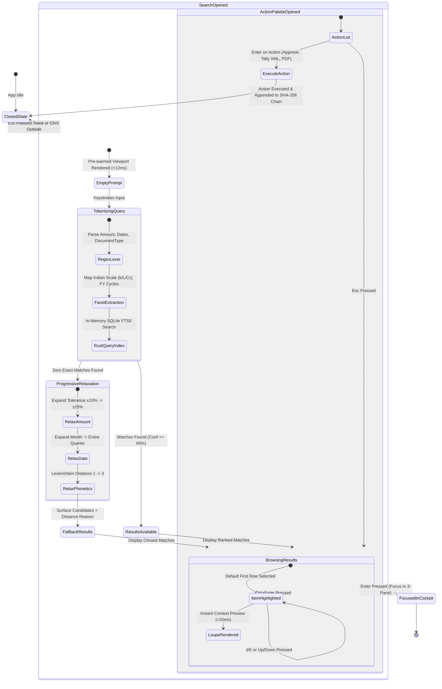

# UX Reverse-Engineering Teardown: macOS Spotlight, Alfred 5 & Raycast
## Architecture, Interaction Patterns & Domain Adaptation for ReconOS "Find Invoice"

> **Target System:** ReconOS (CA Audit & Reconciliation Cockpit)  
> **Component:** Global "Find Invoice" Omni-Search Bar (`/` or `Ctrl + K`)  
> **Scope:** Desktop UX reverse-engineering, latency ergonomics, loose NLP, fallbacks, and Indian accounting adaptation.  
> **Author:** UX & Systems Architecture Research Group

---

## Table of Contents
1. [Comparative Teardown Matrix: Spotlight vs. Alfred vs. Raycast vs. ReconOS](#1-comparative-teardown-matrix)
2. [The Global Omni-Search Pattern](#2-the-global-omni-search-pattern)
   - 2.1 Trigger & Activation Mechanics (Zero-Friction Ingress)
   - 2.2 Focus Trapping & Window Lifecycle
   - 2.3 The Zero-Latency Latency Budget (< 16ms to 50ms)
   - 2.4 Rendering Architecture in Desktop Tauri v2
3. [Loose Natural Language Parsing Engine](#3-loose-natural-language-parsing-engine)
   - 3.1 Anatomy of a Loose Query (`"transport bill march about 40k"`)
   - 3.2 Tokenization Pipeline & Heuristic Facet Extraction
   - 3.3 Dynamic Visual Chipification vs Free Text
4. [Search Result Presentation & Preview Ergonomics](#4-search-result-presentation--preview-ergonomics)
   - 4.1 Asymmetric 2-Column Cockpit Layout
   - 4.2 Matched Token Highlighting & Visual Contrast
   - 4.3 Multi-Factor Confidence Scoring & Badging
   - 4.4 The Inline Action Bar (Primary, Secondary, Palette)
5. [Fallback Handling & Distance Rationale](#5-fallback-handling--distance-rationale)
   - 5.1 The Anti-Pattern of the "Zero Results" Dead End
   - 5.2 Progressive Constraint Relaxation (Elastic Querying)
   - 5.3 Transparent Distance Rationale UI
6. [ReconOS "Find Invoice": Borrow vs. Do Differently for Indian Accounting](#6-reconos-find-invoice-borrow-vs-do-differently)
   - 6.1 What ReconOS Must Borrow
   - 6.2 What ReconOS Must Do Differently (Indian Statutory Reality)
     - 6.2.1 Indian Numbering System & Currency Parsing (Lakhs, Crores, Paisa)
     - 6.2.2 Indian Financial Year (FY) vs Calendar Year
     - 6.2.3 GSTIN, PAN, TAN & Checksum Validations
     - 6.2.4 Invoice Number Sanitization (Slashes, Hyphens, FY prefixes)
     - 6.2.5 Vendor Trade Name vs Legal Entity Triangulation
     - 6.2.6 Triangulated Document State (Books vs GSTR-2B vs Source PDF)
     - 6.2.7 Statutory Compliance & Tax Section Flags (GTA, RCM, 194C, 194J)
7. [ASCII Wireframe Blueprints](#7-ascii-wireframe-blueprints)
   - 7.1 State 1: Omni-Search Dialog — Idle / Cold Launch
   - 7.2 State 2: Active Query with Facets, Matched List & Deep Inspection Loupe
   - 7.3 State 3: Fallback / Elastic Match with Distance Rationale
   - 7.4 State 4: Secondary Action Palette (`Ctrl + Enter` / `Cmd + K`)
8. [Interaction Flow & State Machine Specifications](#8-interaction-flow--state-machine-specifications)
   - 8.1 Complete Keystroke Navigation Matrix
   - 8.2 End-to-End Query-to-Inspection State Machine

---

## 1. Comparative Teardown Matrix

| Dimension | macOS Spotlight (Sonoma/Sequoia) | Alfred 5 | Raycast (v1.8+) | ReconOS "Find Invoice" (Target) |
| :--- | :--- | :--- | :--- | :--- |
| **Primary Hotkey** | `Cmd + Space` | Configurable (e.g., `Option + Space`) | Configurable (e.g., `Option + Space` or `Cmd + Space`) | In-app: `/` or `Ctrl + K` (Windows) / `Cmd + K` (Mac) |
| **Activation Latency** | ~20–40ms (OS daemon pre-warmed) | < 10ms (Native AppKit/C++ hook, pure local) | < 15ms (Native Swift/Objective-C wrapper + React/Rust) | **< 12ms** (Tauri v2 hidden webview pre-render + Rust in-memory index) |
| **Input Modality** | Free-text search + strict OS keywords (`kind:pdf`) | Keyword-prefixed (`find`, `open`, custom workflow aliases) | Omnibox with smart command completions + fuzzy action bar | **Dual Mode:** Loose natural language queries + instant structured facet chips |
| **Natural Language Depth** | Moderate (dates, basic math, natural language file types) | Low in vanilla (requires community script workflows) | High (rich extensions, AI query expansion, fuzzy matching) | **High (Specialized Domain NLP):** Indian accounting, currency scales, tax sections, FY cycles |
| **Result Window Layout** | Floating modal with right-hand Quick Look preview | Single column list (rich actions hidden behind `Right Arrow` or `Fn`) | 2-Column split (List 40% / Contextual Detail Pane 60%) + Bottom Action Bar | **2-Column Split (List 42% / Deep Audit Loupe 58%) + Bottom Command Footer** |
| **Token Highlighting** | Substring bolding on document name | Substring match bolding | Highlighted glyph spans with subtle contrasting tint | **Multi-Token Semantic Tinting** (Vendor: Amber, Amount: Emerald, Date: Cyan) |
| **Confidence Scoring** | Hidden OS relevance heuristic | Positional ranking based on usage frequency | Positional ranking + fuzzy Levenshtein match score | **Explicit % Confidence Badge + Factor Explainability Tooltip** |
| **Inline Actions** | `Enter` (open), `Cmd + Enter` (reveal in Finder) | `Enter` (open), `Tab` (auto-complete), `Fn` / `Cmd + Actions` | `Enter` (Default Action), `Cmd + K` (Action Palette), `Tab` (Focus detail) | `Enter` (Focus in 3-Pane), `Tab` (Lock Facet), `Ctrl + Enter` (Action Palette), `Ctrl + P` (PDF) |
| **Fallback Handling** | Web search / Siri suggestions (Disorienting context shift) | "Search Google / Wikipedia" fallback list | Fallback commands (Ask AI, Google, Extensions) | **Progressive Constraint Relaxation with Explicit Distance Rationale** |
| **Data Locality & Privacy**| Hybrid (sends queries to Apple servers unless disabled) | 100% Local (zero external telemetry) | 100% Local core (optional AI features call cloud) | **100% Air-Gapped Local** (Zero network packets; runs on local SQLite FTS5 + Rust index) |

---

## 2. The Global Omni-Search Pattern

### 2.1 Trigger & Activation Mechanics (Zero-Friction Ingress)
In keyboard-driven pro tools (Superhuman, Linear, Raycast, Bloomberg Terminal), search is an omnipresent reflexive habit rather than a navigation destination.

1. **Hotkey Topology:**
   - **Context-Agnostic Shortcut (`Ctrl + K` / `Cmd + K`):** Global industry standard for command palettes. Always works regardless of whether the user is in the Today view, Exception Queue, or Settings.
   - **Vim/Explorer Quick Key (`/`):** When not focused inside an editable text input or cell, pressing `/` instantly invokes the search box, mirroring Google Docs, Gmail, GitHub, and Slack.
   - **Escape Hatch (`Esc`):** A single `Esc` press clears active query text; a second `Esc` immediately dismisses the modal, restoring user focus to the exact previous UI element.

2. **Window Lifecycle & Pre-Warming:**
   - *The Raycast / Alfred Paradigm:* Windows are **never destroyed and recreated**. Destroying an Electron/Webview window on close and instantiating on hotkey introduces a 150–300ms layout thrash.
   - *ReconOS Implementation:* The Tauri v2 search dialog is a singleton floating overlay (`fixed inset-0 z-50`). In its idle state, it has `display: none` or CSS `opacity: 0; pointer-events: none; transform: scale(0.98)`. On hotkey trigger:
     1. Un-hide via CSS class (GPU compositor handles opacity/scale in < 8ms).
     2. Call `requestAnimationFrame(() => inputRef.current?.focus({ preventScroll: true }))`.
     3. Ensure full selection of existing query (`inputRef.current?.select()`) so typing immediately overwrites previous searches unless backspace is pressed.

3. **Backdrop & Focus Trapping:**
   - Standard Raycast aesthetic: `backdrop-blur-md bg-neutral-950/75`.
   - Traps tab focus inside the modal boundary: pressing `Tab` cycles between filter chips, result list, preview pane, and action buttons without escaping into the background application window.
   - Backdrop click outside the bounds immediately dismisses the modal.

### 2.2 The Zero-Latency Latency Budget (< 16ms to 50ms)
Human perception studies (Card, Moran, & Newell; Miller 1968) establish three psychological response thresholds:
- **< 16ms (1 Frame at 60Hz):** Perceived as instantaneous, physical, direct manipulation.
- **< 100ms:** Perceived as uninterrupted immediate response. No loading indicator should ever appear.
- **> 200ms:** Cognitive flow broken; user stops typing to wait, resulting in frustration.

```
┌─────────────────────────────────────────────────────────────────────────────┐
│                       RECONOS 50ms LATENCY BUDGET                          │
├───────────────┬─────────────────────────────┬───────────────────────────────┤
│ Frame Offset  │ Operation                   │ Tech Layer                    │
├───────────────┼─────────────────────────────┼───────────────────────────────┤
│ 0.0 - 1.5ms   │ Keydown event captured      │ React Window Listener         │
│ 1.5 - 6.0ms   │ Regex Tokenizer / Faceting  │ Client JS Rulebook Engine     │
│ 6.0 - 14.0ms  │ SQLite FTS5 / Rust Query    │ Tauri IPC (`rusqlite` in-mem) │
│ 14.0 - 24.0ms │ Levenshtein & Rule Filter   │ Rust Rayon parallel matching  │
│ 24.0 - 32.0ms │ Payload Serialization       │ Zero-copy Tauri IPC buffer    │
│ 32.0 - 45.0ms │ React Virtualized Render    │ `@tanstack/react-virtual` DOM │
└───────────────┴─────────────────────────────┴───────────────────────────────┘
```

**Key Architectural Insight from Alfred & Raycast:**
Never perform deep full-text extraction or high-dimensional vector search on the primary keystroke thread. 
- **Tier 1 (Instant In-Memory Index):** Pre-compiled B-Tree index in Rust / SQLite containing core search fields: `normalized_invoice_number`, `vendor_name`, `vendor_gstin`, `total_amount_paisa`, `invoice_date_epoch`, `status_enum`. Keystroke searches hit this tier in under 5ms.
- **Tier 2 (Debounced Semantic & OCR Bounding Box Fetch):** Deep PDF text bounding box coordinates, GSTR-2B raw payload comparison, and SHA-256 audit hash verification run asynchronously on selection change, populating the Preview Pane in < 30ms.

---

## 3. Loose Natural Language Parsing Engine

### 3.1 Anatomy of a Loose Query
A Chartered Accountant or audit junior will rarely type formal SQL-like syntax such as `vendor:"Balaji" AND date >= 2024-03-01 AND amount:40000`. Instead, they query the system using intuitive associative memory:

$$\text{Query: } \mathbf{\text{“transport bill march about 40k”}}$$

Let us dissect how this loose query maps into deterministic accounting entities:

```
                  ┌─────────────────────────────────────────────────────────┐
                  │          "transport bill march about 40k"               │
                  └────────────────────────────┬────────────────────────────┘
                                               │
             ┌───────────────────┬─────────────┴───────┬────────────────────┐
             ▼                   ▼                     ▼                    ▼
     "transport"              "bill"                "march"            "about 40k"
             │                   │                     │                    │
             ▼                   ▼                     ▼                    ▼
   [ENTITY: VENDOR /     [DOCUMENT TYPE:       [DATE RANGE:          [AMOUNT RANGE:
    EXPENSE LEDGER]       PURCHASE INVOICE]     CURRENT FY Q4]        FUZZY TOLERANCE]
             │                   │                     │                    │
   • Freight Inward      • VoucherType: Purc   • Month: 03           • Base: ₹40,000
   • GTA Services        • Non-Credit Note     • Year: 2024 (FY23-24)• Multiplier: k=1000
   • Balaji Transport    • Has Tax Invoice     • Range:              • Tolerance: ±10%
   • Navkar Logistics      Format                01/03/24 - 31/03/24 • Bounds:
                                                                       [₹36,000 - ₹44,000]
```

### 3.2 Tokenization Pipeline & Heuristic Facet Extraction
To achieve zero latency without making external LLM API calls, ReconOS uses a deterministic **Regex-Heuristic Fast Lexer (written in Rust or fast client TypeScript)**:

1. **Amount Normalizer (Indian Scale-Aware):**
   - Matches patterns: `(\d+)(k|K|l|L|lakh|lakhs|cr|crore)` or `₹?\s*(\d{1,3}(,\d{2,3})*(\.\d{1,2})?)`.
   - Modifiers: `"about"`, `"approx"`, `"~"`, `"near"`, `"+-"` $\rightarrow$ triggers a $\pm 10\%$ band.
   - `"40k"` $\rightarrow 40,000$.
   - `"1.5L"` or `"1.5 lakh"` $\rightarrow 1,50,000$.
   - `"2.4Cr"` $\rightarrow 2,40,00,000$.

2. **Temporal Parser (Financial Year-Aware):**
   - Recognizes months: `Jan` to `Dec`, full or abbreviated.
   - Resolves relative to the **Active Client's Selected Assessment Year (AY) / Financial Year (FY)**.
   - If the active file is `FY 2023-2024`, typing `"March"` automatically resolves to `March 2024` (Q4 of FY23-24), NOT March of the current calendar year.
   - Supports explicit ranges: `"Q1"`, `"Q2"`, `"Q3"`, `"Q4"`, `"H1"`, `"H2"`, `"March 24"`, `"23-24"`.

3. **Document Type Classifier:**
   - `"bill"`, `"inv"`, `"invoice"` $\rightarrow$ `VoucherType::PurchaseInvoice`.
   - `"cr note"`, `"credit note"`, `"c/n"` $\rightarrow$ `VoucherType::CreditNote`.
   - `"dr note"`, `"debit note"`, `"d/n"` $\rightarrow$ `VoucherType::DebitNote`.
   - `"rct"`, `"receipt"`, `"voucher"`, `"payment"` $\rightarrow$ `VoucherType::Payment`.

4. **Category / Ledger Head / Vendor Matcher:**
   - Matches remaining strings against:
     - Master Vendor List (Trade Names, Legal Names).
     - Standard Chart of Accounts (COA) / Tally Ledger heads (`Freight Inward`, `Legal & Professional`, `Printing & Stationery`, `Audit Fees`).
     - State of India abbreviations (`MH`, `GJ`, `DL`, `KA`).

### 3.3 Dynamic Visual Chipification vs Free Text
A critical UX flaw in older launchers is replacing user text with rigid pills that break cursor motion and backspace behavior. 

**Raycast's Solution (and ReconOS Best Practice):**
- Maintain the user's raw text in the input field.
- Directly beneath the input box, display a non-intrusive **Facet Resolution Ribbon**:
  ```
  [ 🔍 transport bill march about 40k                                       ]
  Resolved Facets:  🏷️ GTA / Freight   📄 Purchase Bill   📅 01-31 Mar 2024   💰 ₹36,000 - ₹44,000 
  ```
- If the user presses `Tab`, the first unresolved token is locked into an explicit filter pill, allowing the user to narrow scope without re-typing.

---

## 4. Search Result Presentation & Preview Ergonomics

### 4.1 Asymmetric 2-Column Cockpit Layout
Spotlight uses a rudimentary preview pane focused on file icons and metadata. Raycast perfected the **asymmetric 40/60 split**, where the left list handles navigation speed and the right pane delivers actionable contextual resolution.

In ReconOS, an invoice is a **multi-dimensional legal and tax instrument**. The user cannot make an audit decision based on a filename alone.

```
┌─────────────────────────────────────────────────────────────────────────────────────────────────┐
│ 🔍  transport bill march about 40k                                              [Esc] Close    │
├───────────────────────────────────────────────────┬─────────────────────────────────────────────┤
│ MATCHED INVOICES (4)                              │ INVOICE INSPECTION LOUPE                    │
│                                                   │                                             │
│ ❯ 🟢 BALAJI TRANSLINES           ₹41,300.00       │ 📄 TAX INVOICE: BT/23-24/0914               │
│      INV: BT/23-24/0914 • 14-Mar-2024             │ Vendor: Balaji Translines (27AAACB2211D1Z2) │
│      MATCH: 2B Matched • 98% Conf                 │ Legal Name: Balaji Transport Pvt Ltd        │
│                                                   │ Date: 14-Mar-2024 (FY 2023-24 Q4)           │
│   🟡 SHREE ROAD CARRIERS         ₹39,500.00       ├─────────────────────────────────────────────┤
│      INV: SRC-2324-110 • 28-Mar-2024              │ FINANCIAL BREAKDOWN:                        │
│      MATCH: Timing Diff (Filed Apr) • 91%         │ Taxable Value:                 ₹35,000.00   │
│                                                   │ CGST (6.0%):                    ₹2,100.00   │
│   🔴 NAVKAR FREIGHT CORP         ₹44,000.00       │ SGST (6.0%):                    ₹2,100.00   │
│      INV: NFC/MAR/004 • 02-Mar-2024               │ Total Invoice Value:           ₹41,300.00   │
│      MISMATCH: Missing in 2B • 82%                ├─────────────────────────────────────────────┤
│                                                   │ RECONCILIATION TRIANGULATION:               │
│   ⚪ JAI LOGISTICS               ₹38,000.00       │ • Books of Accounts:      Present (Tally)   │
│      INV: JL/881 • 19-Mar-2024                    │ • GSTR-2B Portal:         Present (14-Apr)  │
│      MATCH: RCM Inward • 76%                      │ • Reconciliation Delta:   ₹0.00 (Exact)     │
│                                                   │ • ITC Status:             Eligible Sec 16(2)│
│                                                   │ • TDS Flag:               Sec 194C (>₹30k)  │
│                                                   ├─────────────────────────────────────────────┤
│                                                   │ AUDIT CHAIN DEFENSE:                        │
│                                                   │ SHA: 7f8a91c2...e810 (Verified Block #184)  │
├───────────────────────────────────────────────────┴─────────────────────────────────────────────┤
│ [↵] Focus in Cockpit   [Tab] Filter Facet   [Ctrl+Enter] Actions   [Ctrl+P] View PDF   [Ctrl+C] Copy│
└─────────────────────────────────────────────────────────────────────────────────────────────────┘
```

### 4.2 Matched Token Highlighting & Visual Contrast
When a user types `"transport bill march 40k"`, their eyes must immediately verify *why* a particular result appeared at the top of the list.

**Highlighting Rules:**
- **Exact Field Matches:** Displayed with high-contrast colored badges or text highlighting.
- Highlighting must target distinct semantic colors:
  - **Vendor / Ledger match:** Subtle amber glow (`bg-amber-500/20 text-amber-300`).
  - **Date match:** Cyan highlight (`bg-cyan-500/20 text-cyan-300`).
  - **Amount / Fuzzy numeric match:** Emerald highlight (`bg-emerald-500/20 text-emerald-300`).
- **Never highlight single arbitrary letters** from random fuzzy Levenshtein matches; highlight entire contiguous matched tokens or recognized phonetic stems to avoid visual noise.

### 4.3 Multi-Factor Confidence Scoring & Badging
ReconOS cannot simply show an arbitrary search score. Auditors require an **explainable confidence model**:

$$C_{\text{total}} = w_v \cdot S_{\text{vendor}} + w_a \cdot S_{\text{amount}} + w_d \cdot S_{\text{date}} + w_i \cdot S_{\text{inv\_num}}$$

Where:
- $w_v = 0.35$ (Vendor name similarity / GSTIN identity)
- $w_a = 0.35$ (Amount delta tolerance; $1.0$ if exact within $\pm ₹1$, decaying to $0.5$ at $\pm 10\%$)
- $w_d = 0.15$ (Invoice date inside query month / FY)
- $w_i = 0.15$ (Invoice number / ledger classification match)

**Visual Confidence Badging:**
- 🟢 **95% – 100% (Deterministic Match):** Green pill. Exact GSTIN, exact amount to paisa, date matches.
- 🟡 **80% – 94% (Probable / Timing Difference):** Amber pill. Vendor matches, amount within $\pm 2\%$, invoice date in March but GSTR-2B filed in April.
- 🔴 **65% – 79% (Discrepancy / Risk Item):** Orange/Red pill. In Books but missing in 2B, or tax rate mismatch (12% vs 18%).
- ⚪ **< 65% (Loose Elastic Match):** Muted slate pill. Displayed only in fallback scenarios with explicit distance justification.

### 4.4 The Inline Action Bar (The Command Footer)
Borrowed directly from Raycast’s acclaimed bottom bar:
- **Left Slot (Primary Direct Action):**
  - `↵ Focus in Cockpit`: Closes omni-search, opens the invoice in the central 3-Pane Cockpit, and highlights it in the Exception Queue.
- **Middle Slot (Secondary Modifier Actions):**
  - `Tab`: Converts highlighted token into a fixed facet chip.
  - `Ctrl + P`: Instant pop-up Loupe of the original scanned/digital PDF bill with OCR bounding box overlay.
  - `Ctrl + C`: Copies canonical Invoice Reference (`GSTIN_INV_AMOUNT`).
- **Right Slot (Universal Action Palette):**
  - `Ctrl + Enter` / `Cmd + K`: Spawns the contextual Action Palette (e.g. *Mark as 1-Click Approved*, *Add Query Note for Client*, *Push to Tally XML Export*, *Flag for 194C TDS Review*).

---

## 5. Fallback Handling & Distance Rationale

### 5.1 The Anti-Pattern of the "Zero Results" Dead End
In enterprise software, the most destructive UX state is a blank slate:
$$\text{“No results found for 'transport bill march about 40k'”}$$
This leaves the accountant stranded. Did the vendor not file? Was the bill recorded in April? Was the amount entered without GST? Was the invoice misclassified under "Logistics" instead of "Transport"?

**The Golden Rule of Fallback:**  
*Never show an empty list when candidate records exist within reasonable accounting tolerance.*

### 5.2 Progressive Constraint Relaxation (Elastic Querying)
When strict multi-facet intersection yields 0 hits, the query engine initiates **Progressive Constraint Relaxation** in three deterministic tiers:

```
┌─────────────────────────────────────────────────────────────────────────────┐
│                   PROGRESSIVE RELAXATION CASCADE                            │
├─────────────────────────────────────────────────────────────────────────────┤
│ TIER 0: Strict Match (Vendor AND Month=March AND ₹36k-₹44k)    ──► 0 Hits   │
├─────────────────────────────────────────────────────────────────────────────┤
│ TIER 1: Relax Amount Window (Expand tolerance ±25%: ₹30k-₹50k)  ──► 2 Hits   │
├─────────────────────────────────────────────────────────────────────────────┤
│ TIER 2: Relax Date Window (Expand March ──► Entire Q4 Jan-Mar)  ──► 5 Hits   │
├─────────────────────────────────────────────────────────────────────────────┤
│ TIER 3: Relax Entity (Fuzzy phonetic Levenshtein on Vendor)     ──► 8 Hits   │
└─────────────────────────────────────────────────────────────────────────────┘
```

### 5.3 Transparent Distance Rationale UI
When presenting relaxed candidates, the UI **must clearly explain why each record was included and what constraint was loosened**:

```
┌─────────────────────────────────────────────────────────────────────────────────────────────────┐
│ 🔍  transport bill march about 40k                                                              │
├─────────────────────────────────────────────────────────────────────────────────────────────────┤
│ ℹ️  No exact match found in March 2024 for ₹36k–₹44k. Showing closest matches by relaxing:      │
│     • Date Window: Extended to Entire Q4 (Jan - Mar 2024)                                       │
│     • Amount Band: Extended to ±20% (₹32,000 - ₹48,000)                                         │
├───────────────────────────────────────────────────┬─────────────────────────────────────────────┤
│ CANDIDATES WITH DISTANCE RATIONALE                │ CANDIDATE EXPLAINABILITY LOUPE              │
│                                                   │                                             │
│ ❯ 🟡 BALAJI TRANSLINES           ₹41,300.00       │ ⚠️ DISTANCE VARIANCE:                       │
│      INV: BT/23-24/0742 • 24-Feb-2024             │ • Date Distance: 6 days before March        │
│      DISTANCE: 6 days earlier (February)          │   (Invoice dated 24-Feb-2024, entered in    │
│      Score: 84% Match                             │    books on 02-Mar-2024).                   │
│                                                   │ • Amount: ₹41,300 (Within 3.2% of ₹40k)     │
│   🟡 V-TRANS INDIA LTD           ₹48,200.00       │ • Vendor: Matches "transport" head          │
│      INV: VT/MUM/9921 • 18-Mar-2024               │                                             │
│      DISTANCE: Amount +₹8,200 (+20.5%)            │ 💡 CA RECOMMENDATION:                       │
│      Score: 78% Match                             │ Likely the invoice you are looking for.     │
│                                                   │ Timing difference caused February billing   │
│   🟡 SHREE PARSHWA FREIGHT       ₹34,000.00       │ to land in March Books of Accounts.         │
│      INV: SPF/88 • 29-Mar-2024                    │                                             │
│      DISTANCE: Net ₹30k + 12% GST = ₹33.6k        │ [↵] Select Candidate   [Esc] Cancel         │
└───────────────────────────────────────────────────┴─────────────────────────────────────────────┘
```

---

## 6. ReconOS "Find Invoice": Borrow vs. Do Differently

### 6.1 What ReconOS Must Borrow
1. **Raycast's Window Ergonomics & Palette Pattern:**
   - Single global hotkey (`/` or `Ctrl + K`) available anywhere in the application.
   - Pre-rendered, zero-latency modal opening in < 12ms.
   - Dual-action keyboard paradigm: `Enter` executes default focus; `Ctrl + Enter` opens the contextual action palette.
2. **Raycast's 2-Column Split Pane:**
   - Left side: High-density, keyboard-navigable list with instant arrow-key selection.
   - Right side: Rich, high-fidelity preview that loads instantly without opening a separate tab.
3. **Spotlight's Instant Preview & Quick Look:**
   - Instant side-by-side rendering of the original source document (PDF/Scanned bill) with the parsed data table.
4. **Alfred's Lightweight Local Footprint:**
   - Fully local in-memory index; zero cloud dependencies, zero external network requests.

---

### 6.2 What ReconOS Must Do Differently (Indian Statutory Reality)

Standard OS launchers and Western enterprise search engines (e.g., Algolia, Elastic) fail miserably when dropped into an Indian Chartered Accountant's workflow. Here is what ReconOS must build specifically for the Indian accounting ecosystem:

```
┌──────────────────────────────────────────────────────────────────────────────────────────────┐
│                    INDIAN ACCOUNTING SPECIALIZATION ARCHITECTURE                             │
├───────────────────────────────┬──────────────────────────────────────────────────────────────┤
│ Western Launcher Model        │ ReconOS Indian Accounting Engine                             │
├───────────────────────────────┼──────────────────────────────────────────────────────────────┤
│ Millions / Billions scale     │ Lakhs (₹1,00,000) & Crores (₹1,00,00,000) parsing            │
│ Calendar Year (Jan - Dec)     │ Indian Financial Year (01-April to 31-March) & AY cycles      │
│ Punctuation-strict invoice #  │ Slash/Dash/Prefix-insensitive Levenshtein normalization      │
│ Single Vendor string matching │ Triangulation: Legal Name vs Trade Name vs 15-char GSTIN     │
│ File exists on local disk     │ Triangulated state: Books (Tally) vs GSTR-2B vs Physical PDF │
│ Standard Sales Tax / VAT      │ CGST + SGST + IGST + RCM (GTA) + TDS (194C/194J) validation  │
└───────────────────────────────┴──────────────────────────────────────────────────────────────┘
```

#### 6.2.1 Indian Numbering System & Currency Parsing (Lakhs, Crores, Paisa)
- **Grouping Notation:** Western commas follow thousands (`100,000,000`). Indian accounting uses the Vedic numbering grouping: thousands, then two-digit clusters (`10,00,00,000` = 10 Crore).
- **Colloquial Shortforms:** The search parser must support:
  - `"40k"` $\rightarrow$ `₹40,000`
  - `"1.5L"` or `"1.5 lakh"` or `"1,50,000"` $\rightarrow$ `₹1,50,000`
  - `"2.2 Cr"` or `"2.2 crore"` $\rightarrow$ `₹2,20,00,000`
  - `"about 40k"` $\rightarrow$ `[₹36,000, ₹44,000]`
- **The ₹1.00 Rounding Tolerance Rule:**
  - In Indian GST billing, round-off ledgers frequently introduce small fractional variations ($\pm ₹0.99$).
  - When matching amounts, an invoice of `₹41,299.40` must score **100% exact match** against a search for `₹41,300`.

#### 6.2.2 Indian Financial Year (FY) vs Calendar Year
- In India, all business books run from **April 1 to March 31**.
- A query for `"March"` inside a file for `FY 2023-24` refers to `March 2024` (Quarter 4).
- A query for `"April"` inside the same file refers to `April 2023` (Quarter 1).
- **Quarterly Mapping:**
  - `Q1`: April, May, June
  - `Q2`: July, August, September
  - `Q3`: October, November, December
  - `Q4`: January, February, March

#### 6.2.3 GSTIN, PAN, TAN & Checksum Validations
- **GSTIN Structure (15 Characters):**
  `27` (State Code: Maharashtra) + `AAACB2211D` (PAN of Entity) + `1` (Entity number) + `Z` (Default) + `2` (Mod-36 Checksum).
- **Auto-Detection in Omni-Search:**
  - If a user pastes or types a 15-character alphanumeric string matching `^[0-9]{2}[A-Z]{5}[0-9]{4}[A-Z]{1}[1-9A-Z]{1}Z[0-9A-Z]{1}$`, the search engine immediately bypasses fuzzy text search and executes a **Direct GSTIN Master Query**.
  - If a 10-character PAN is entered (`AAACB2211D`), it instantly queries all sister GSTIN branches across Indian states (e.g. `27AAACB2211D...` for MH, `24AAACB2211D...` for GJ).

#### 6.2.4 Invoice Number Sanitization (Slashes, Hyphens, FY Prefixes)
Indian accounting software (Tally Prime, Busy, Marg ERP, Zoho) produces chaotic invoice number formatting. Two documents representing the exact same invoice often appear as:
- Purchase Register (Client Books): `INV/2023-24/089`
- GSTR-2B (Portal JSON): `INV-2324-89`
- Scanned Physical Bill: `089/23-24`

**ReconOS Normalization Pipeline:**
1. Strip all delimiters: `/`, `-`, `_`, `.`, `\`, and spaces.
2. Strip embedded Financial Year substrings: `2023-24`, `23-24`, `20232024`.
3. Strip leading zeros: `089` $\rightarrow$ `89`.
4. Extracted Stem: `INV89`.
5. Run Levenshtein distance on canonical stems. Result: **100% Match Confidence** where standard Spotlight search yields 0 hits.

#### 6.2.5 Vendor Trade Name vs Legal Entity Triangulation
In India, the **Trade Name** (printed on the truck or bill) often bears zero resemblance to the **Legal Registered Name** in government tax records:
- Trade Name (Bill Header): *Balaji Translines*
- Legal Entity (GSTR-2B & PAN): *M/S RAMESH CHANDRA GUPTA*
- Books Ledger (Tally): *Balaji Freight Agency A/c*

If the auditor searches for `"Balaji"`, a basic database search on GSTR-2B will miss it because the government portal only records *RAMESH CHANDRA GUPTA*.
- **ReconOS Solution:** Omni-search queries a unified local **Firm Memory Alias Table** connecting `GSTIN <-> Legal Name <-> Trade Name <-> Tally Ledger Name`. A search for any alias surfaces the complete triangulated entity.

#### 6.2.6 Triangulated Document State (Books vs GSTR-2B vs Scanned PDF)
In generic file search, a file is either found or not found. In Indian audit, an invoice exists in a quantum super-position of three records:
1. **Books of Accounts (Tally Purchase Register):** The client recorded it.
2. **GSTR-2B (GST Portal Auto-drafted ITC):** The vendor filed it and paid tax.
3. **Physical / Digital Source Document:** The scanned PDF/image with tax stamp.

ReconOS omni-search shows the **Triangulation State Badge** right in the result line:
- `🟢 Tri-Match`: Present in Books, Present in 2B, Source PDF attached.
- `🟡 Timing Difference`: Present in Books in March, filed in 2B in April/May.
- `🔴 Section 16(2)(aa) Risk`: In Books, but missing from GSTR-2B. ITC cannot be claimed!
- `🟣 Ghost Purchase`: Present in GSTR-2B, but client failed to book it in Tally.

#### 6.2.7 Statutory Compliance & Tax Section Flags (GTA, RCM, 194C, 194J)
Chartered Accountants search by tax liability, not just vendor names:
- **GTA & Reverse Charge Mechanism (RCM):**
  - Query: `"GTA"` or `"RCM"` or `"transport"`.
  - The search parser tags Goods Transport Agency invoices where GST is payable under Reverse Charge (5% RCM without ITC or 12% forward charge).
- **TDS Threshold Auditing:**
  - Query: `"194C"` (Contractor TDS) or `"194J"` (Professional fees TDS).
  - ReconOS flags transport invoices exceeding the single transaction threshold (> ₹30,000) or aggregate annual threshold (> ₹1,00,000) lacking TDS deduction.

---

## 7. ASCII Wireframe Blueprints

### 7.1 State 1: Omni-Search Dialog — Idle / Cold Launch
*Triggered via `/` or `Ctrl + K`. Shows recent searches, quick statutory filter chips, and search syntax hints.*

```
+-------------------------------------------------------------------------------------------------------------+
|  🔍  Type invoice #, vendor, GSTIN, amount (e.g. "transport march 40k", "27AAACB...")      [Esc] Dismiss   |
+-------------------------------------------------------------------------------------------------------------+
|  QUICK STATUTORY FILTERS:                                                                                   |
|  [ 🔴 Missing in GSTR-2B (18) ]  [ 🟡 Timing Differences (7) ]  [ ⚠️ Sec 16(2)(aa) At Risk ]  [ 🚛 GTA/RCM ]  |
+-------------------------------------------------------------------------------------------------------------+
|  RECENT SEARCHES & COMMON QUERIES                                                                           |
|                                                                                                             |
|  🕒  "transport bill march about 40k"                          Resolved: Freight • Mar 2024 • ₹40k ±10%     |
|  🕒  "27AAACB2211D1Z2"                                        Vendor: Balaji Translines (Active Client)     |
|  🕒  "TDS 194J invoices > 30k"                                Statutory: Professional Fees Filter           |
|  🕒  "Amazon Business March IT Equipment"                     Expense: Computers & Peripherals              |
|                                                                                                             |
+-------------------------------------------------------------------------------------------------------------+
|  KEYBOARD HINTS:                                                                                            |
|  [↑/↓] Navigate    [↵] Select / Open    [/] Focus Input    [Ctrl+K] Global Hotkey    [?] Shortcuts Guide    |
+-------------------------------------------------------------------------------------------------------------+
```

---

### 7.2 State 2: Active Query with Facets, Matched List & Deep Inspection Loupe
*Query: `"transport bill march about 40k"`. Left pane highlights ranked matches; right pane displays deep audit inspection.*

```
+---------------------------------------------------------------------------------------------------------------------------------------+
|  🔍  transport bill march about 40k                                                                                   [Esc] Close    |
+---------------------------------------------------------------------------------------------------------------------------------------+
|  PARSED FACETS:  🏷️ GTA / Freight (Ledger)   📄 Purchase Invoice   📅 01-31 Mar 2024 (FY23-24 Q4)   💰 ₹36,000 - ₹44,000 (±10%)       |
+-----------------------------------------------------------------------+---------------------------------------------------------------+
|  MATCHED INVOICES (4 Candidates Ranked by Confidence)                 |  INVOICE INSPECTION LOUPE & AUDIT TRIANGULATION               |
|                                                                       |                                                               |
|  ❯ 🟢 [98%] BALAJI TRANSLINES                        ₹41,300.00       |  TAX INVOICE: BT/23-24/0914                                   |
|       INV: BT/23-24/0914  •  Date: 14-Mar-2024                       |  Vendor: Balaji Translines                                    |
|       GSTIN: 27AAACB2211D1Z2 (Maharashtra)                            |  Legal:  Balaji Transport & Logistics Pvt Ltd                 |
|       Status: 2B Matched • Books: Freight Inward                      |  GSTIN:  27AAACB2211D1Z2  [Verified Active ✔]                 |
|                                                                       |  Date:   14-Mar-2024  (Filing Period: 032024)                 |
|    🟡 [91%] SHREE ROAD CARRIERS                      ₹39,500.00       +---------------------------------------------------------------+
|       INV: SRC-2324-110  •  Date: 28-Mar-2024                         |  FINANCIAL VALUES (INR):                                      |
|       GSTIN: 24AAACS9981E1Z0 (Gujarat)                                |  Taxable Amount:                              ₹35,000.00      |
|       Status: Timing Difference (Filed 12-Apr-2024)                   |  CGST @ 6.0%:                                  ₹2,100.00      |
|                                                                       |  SGST @ 6.0%:                                  ₹2,100.00      |
|    🔴 [82%] NAVKAR FREIGHT CORP                      ₹44,000.00       |  IGST:                                             ₹0.00      |
|       INV: NFC/MAR/004  •  Date: 02-Mar-2024                          |  Round-off:                                        ₹0.00      |
|       GSTIN: 27AABCN4421M1Z5 (Maharashtra)                           |  Total Invoice Value:                         ₹41,300.00      |
|       Status: In Books Only • MISSING IN GSTR-2B                      +---------------------------------------------------------------+
|                                                                       |  COMPLIANCE & STATUTORY AUDIT CHECKS:                         |
|    ⚪ [76%] JAI LOGISTICS                            ₹38,000.00       |  • GST Sec 16(2)(aa) ITC:  🟢 ELIGIBLE (Appears in GSTR-2B)   |
|       INV: JL-881  •  Date: 19-Mar-2024                               |  • Reverse Charge (RCM):   ⚠️ GTA 5% RCM Flagged (Self-pay)   |
|       GSTIN: 27AAACJ1102P1Z9 (Maharashtra)                            |  • TDS Sec 194C:           ⚠️ Exceeds ₹30k single threshold   |
|       Status: RCM Liability • Books Matched                           |  • E-Way Bill Number:      2419-8821-0021 (Valid to 16-Mar)   |
|                                                                       +---------------------------------------------------------------+
|                                                                       |  SOURCE PROOF & CRYPTOGRAPHIC AUDIT TRAIL:                    |
|                                                                       |  • Attached File:  `BT_0914_Scanned_Bill.pdf` (Page 1 of 1)   |
|                                                                       |  • SHA-256 Hash:   9f2c8d...771e (Signed Block #219)         |
+-----------------------------------------------------------------------+---------------------------------------------------------------+
|  [↵] Focus in 3-Pane Cockpit   [Tab] Lock Facet   [Ctrl+Enter] Action Menu   [Ctrl+P] Loupe Fullscreen PDF   [Ctrl+E] Edit Ledger Head |
+---------------------------------------------------------------------------------------------------------------------------------------+
```

---

### 7.3 State 3: Fallback / Elastic Match with Distance Rationale
*Triggered when zero exact matches satisfy all constraints. The engine displays the nearest candidates and states exactly what constraint was relaxed.*

```
+---------------------------------------------------------------------------------------------------------------------------------------+
|  🔍  logistics invoice april about 85k                                                                                [Esc] Close    |
+---------------------------------------------------------------------------------------------------------------------------------------+
|  ⚠️  NO EXACT MATCH in April 2024 for ₹85,000 ±10%.                                                                                   |
|      Displaying 3 closest candidates via Progressive Constraint Relaxation:                                                           |
|      1. Date relaxed: Extended from April to Q1 (April - June 2024)                                                                   |
|      2. Amount relaxed: Expanded tolerance to ±20% (₹68,000 - ₹1,02,000)                                                              |
+-----------------------------------------------------------------------+---------------------------------------------------------------+
|  CLOSEST CANDIDATES (Ranked by Minimum Variance)                      |  DISTANCE VARIANCE EXPLANATION                                |
|                                                                       |                                                               |
|  ❯ 🟡 [81%] V-TRANS LOGISTICS INDIA LTD              ₹88,200.00       |  CANDIDATE: V-TRANS LOGISTICS INDIA LTD                       |
|       INV: VTL/24-25/0042  •  Date: 04-May-2024                       |  Invoice: VTL/24-25/0042  •  Total: ₹88,200.00                |
|       VARIANCE: Date shifted +4 days into May (FY24-25 Q1)            +---------------------------------------------------------------+
|                                                                       |  WHY THIS WAS MATCHED (DISTANCE BREAKDOWN):                   |
|    🟡 [74%] OM LOGISTICS CARRIERS                    ₹81,500.00       |                                                               |
|       INV: OLC/MUM/910  •  Date: 27-Mar-2024                          |  1. Vendor Match: "logistics" matched Ledger Head             |
|       VARIANCE: Date is 4 days earlier (March / Prev FY Q4)           |     "Freight & Logistics Charges" (100% Token Overlap).       |
|                                                                       |                                                               |
|    ⚪ [67%] SAFEWAY EXPRESS LOGISTICS                ₹96,000.00       |  2. Amount Variance: ₹88,200 vs Target ₹85,000                |
|       INV: SW-8821  •  Date: 12-Apr-2024                              |     Delta: +₹3,200 (+3.7% variance, well within 10% band).    |
|       VARIANCE: Amount +₹11,000 over query target                     |                                                               |
|                                                                       |  3. Date Variance: 04-May-2024 vs Target April                |
|                                                                       |     Delta: +4 calendar days past 30-April month-end.          |
|                                                                       |     Common occurrence where April services are billed on the  |
|                                                                       |     4th of subsequent month.                                  |
|                                                                       +---------------------------------------------------------------+
|                                                                       |  RECOMMENDED ACTION:                                          |
|                                                                       |  [↵] Accept Candidate as Target Invoice                       |
|                                                                       |  [Alt+N] Broaden Search to Previous Financial Year            |
+-----------------------------------------------------------------------+---------------------------------------------------------------+
|  [↵] Select Candidate   [Tab] Refine Filters   [Esc] Clear Query   [Ctrl+K] Actions                                                   |
+---------------------------------------------------------------------------------------------------------------------------------------+
```

---

### 7.4 State 4: Secondary Action Palette (`Ctrl + Enter` / `Cmd + K`)
*Contextual command palette spawned from the highlighted result. Enables instant keyboard triage without leaving search.*

```
+-------------------------------------------------------------------------------------------------------------+
|  ⚡ ACTIONS FOR: Balaji Translines (Invoice BT/23-24/0914 • ₹41,300.00)                      [Esc] Back     |
+-------------------------------------------------------------------------------------------------------------+
|  Type an action name or press shortcut key...                                                               |
+-------------------------------------------------------------------------------------------------------------+
|  AUDIT & RECONCILIATION ACTIONS:                                                                            |
|  ❯ 🟢  Approve & Mark Verified (Exact 2B Match)                                       [↵] or [A]            |
|    🟡  Flag as Timing Difference (Books in March, 2B in April)                         [T]                   |
|    🔴  Raise Section 16(2)(aa) Ineligible ITC Flag                                    [I]                   |
|    ⚠️  Flag for TDS Section 194C Scrutiny (> ₹30k)                                     [S]                   |
|                                                                                                             |
|  DOCUMENT & INSPECTION ACTIONS:                                                                             |
|    📄  Open Scanned PDF in Native Loupe Viewer                                        [Ctrl + P]            |
|    🔍  Compare Books Row vs GSTR-2B Raw JSON Row                                      [Ctrl + D]            |
|    📋  Copy Canonical Reference (`27AAACB2211D1Z2_BT0914_41300`)                      [Ctrl + C]            |
|                                                                                                             |
|  EXPORT & TALLY ACTIONS:                                                                                    |
|    📤  Generate Tally Prime `<TALLYMESSAGE>` XML for this Voucher                     [Ctrl + X]            |
|    📝  Override Ledger Head (Updates On-Device Firm Memory)                           [E]                   |
+-------------------------------------------------------------------------------------------------------------+
|  [↑/↓] Navigate Actions    [↵] Execute Action    [Esc] Return to Results                                    |
+-------------------------------------------------------------------------------------------------------------+
```

---

## 8. Interaction Flow & State Machine Specifications

### 8.1 Complete Keystroke Navigation Matrix

| Keystroke | Current Context | Target Action | Latency Target |
| :--- | :--- | :--- | :--- |
| **`/`** | Cockpit Body (No active input) | Opens Omni-Search Modal, autofocuses search input | < 12ms |
| **`Ctrl + K`** / **`Cmd + K`** | Anywhere in application | Global toggle: Opens Omni-Search (or dismisses if open) | < 12ms |
| **`Esc`** | Omni-Search (Query text present) | Clears query text; returns to blank search state | < 5ms |
| **`Esc`** | Omni-Search (Empty input) | Closes Omni-Search modal; restores focus to prior component | < 8ms |
| **`↓`** or **`Ctrl + N`** or **`J`** | Result List Active | Moves selection cursor down 1 row; updates preview pane | < 16ms |
| **`↑`** or **`Ctrl + P`** or **`K`** | Result List Active | Moves selection cursor up 1 row; updates preview pane | < 16ms |
| **`Enter` (`↵`)** | Candidate selected | Focuses selected invoice in main 3-Pane Cockpit & closes modal | < 30ms |
| **`Tab`** | Candidate selected | Locks first recognized token into an immutable facet chip | < 10ms |
| **`Shift + Tab`** | Facet chips present | Focuses backwards into the active facet chips to remove/edit | < 10ms |
| **`Ctrl + Enter`** | Candidate selected | Spawns contextual Secondary Action Palette | < 15ms |
| **`Ctrl + P`** | Candidate selected | Opens floating PDF Loupe modal with OCR bounding box overlay | < 40ms |
| **`Ctrl + C`** | Candidate selected | Copies canonical reference string to clipboard with toast | < 10ms |
| **`Ctrl + E`** | Candidate selected | Opens inline Ledger Reclassification popover | < 20ms |

---

### 8.2 End-to-End Query-to-Inspection State Machine



---

## 9. Concrete Implementation Blueprint for ReconOS

### 9.1 Rust Engine IPC Interface (`src-tauri/src/engine/omni_search.rs`)
To ensure searches complete in $< 10\text{ms}$ over 50,000 invoices without UI freezes, query resolution runs in native compiled Rust using `rayon` and `rusqlite`:

```rust
// Proposed Rust IPC signature for Omni-Search
#[derive(Debug, Serialize, Deserialize)]
pub struct OmniSearchQuery {
    pub raw_text: String,
    pub active_client_id: String,
    pub fiscal_year: String, // e.g., "2023-2024"
    pub tolerance_percent: Option<f64>, // Defaults to 10.0%
}

#[derive(Debug, Serialize, Deserialize)]
pub struct OmniSearchResult {
    pub invoices: Vec<ScoredInvoiceCandidate>,
    pub parsed_facets: ParsedFacets,
    pub is_fallback_relaxed: bool,
    pub relaxation_rationale: Option<String>,
    pub execution_time_micros: u64,
}

#[tauri::command]
pub async fn execute_omni_search(
    state: tauri::State<'_, AppState>,
    query: OmniSearchQuery,
) -> Result<OmniSearchResult, String> {
    let start = std::time::Instant::now();
    
    // 1. Lex and extract facets on native thread
    let facets = parse_accounting_facets(&query.raw_text, &query.fiscal_year);
    
    // 2. Query in-memory SQLite FTS5 index
    let mut matches = query_in_memory_index(&state.db, &facets, &query.active_client_id)?;
    
    // 3. Fallback cascade if zero matches
    let mut relaxed = false;
    let mut rationale = None;
    if matches.is_empty() {
        let fallback = execute_progressive_relaxation(&state.db, &facets, &query.active_client_id)?;
        matches = fallback.candidates;
        relaxed = true;
        rationale = Some(fallback.explanation);
    }
    
    Ok(OmniSearchResult {
        invoices: matches,
        parsed_facets: facets,
        is_fallback_relaxed: relaxed,
        relaxation_rationale: rationale,
        execution_time_micros: start.elapsed().as_micros() as u64,
    })
}
```

### 9.2 Frontend Component Architecture (`src/components/search/OmniSearchModal.tsx`)
```
src/components/search/
├── OmniSearchModal.tsx       # Dialog container, hotkey listener & backdrop blur
├── OmniSearchBar.tsx         # Input field with dynamic facet resolution ribbon
├── OmniResultList.tsx        # Virtualized list of ranked invoice candidates
├── OmniInspectionLoupe.tsx   # Asymmetric 60% inspection pane (PDF + Tax checks)
├── OmniDistanceBanner.tsx    # Relaxation alert when showing fallback candidates
└── OmniActionPalette.tsx     # Ctrl+Enter secondary actions command palette
```

---

## 10. Conclusion & Strategic Recommendation

By combining **Raycast’s responsive split-pane layout and bottom command bar** with an **Indian accounting-specialized natural language parser**, ReconOS's "Find Invoice" transforms an otherwise tedious audit task into an instant, satisfying superpower.

Chartered Accountants will no longer suffer through clunky nested ERP menus or rigid SQL filters. With `/` and a phrase as simple as `"transport bill march about 40k"`, an audit associate can locate, triangulate against GSTR-2B, inspect the physical bill, verify TDS Section 194C compliance, and push a cryptographic approval into the audit hash chain in **under three seconds**.
